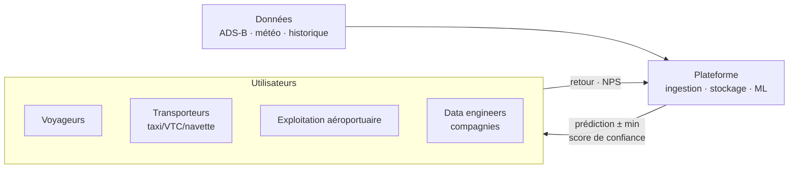
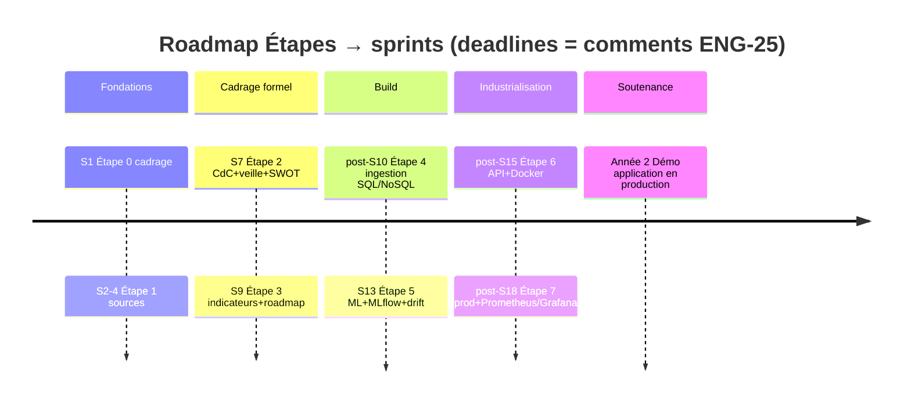
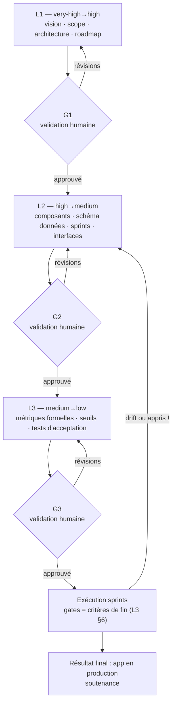

# L1 — Strategy & Architecture (very-high → high level)

> **Level 1 of 3** — validate *what* we build, *why*, *for whom*, and the *skeleton* of how.
> **Gate G1** (human review): all G1 checklist items at the bottom approved before details of [L2](L2-architecture.md) are considered locked.
> Sources: [Cahier des charges DST_JBM_Airlines](https://linear.app/testaafdkjslkdgj/issue/ENG-25) (PDF), Étapes 0–7 (issue comments), 4 research reports in [`docs/research/`](../research/).

---

## 1. Vision (one sentence)

**A plateforme d'intelligence aéronautique CDG (LFPG) → Genève (LSGG)** qui, en croisant données temps-réel ADS-B, météo et ML, **prédit les retards ≥ 1 h avant l'affichage officiel** et les restitue sur une carte vivante — pour les voyageurs, les opérateurs aéroportuaires et les transporteurs.

## 2. Scope

### 2.1 In — MVP (cahier §8) + committed features

| # | Feature | Source | Core acceptance (detail → L3) |
|---|---|---|---|
| F1 | Moteur de recherche (n° de vol, ou ville départ/arrivée) | CdC §3, §8 | Résultat < 2 s, données justes |
| F2 | Fiche de vol détaillée (provenance, escale, destination, appareil, météo locale) | CdC §3 | Tous champs présents, source tracée |
| F3 | Carte temps réel (icônes avions + trajectoires) | CdC §3, §8 | Rafraîchie ≤ 30 s |
| F4 | Module alertes & prédiction : retard, motif, météo, score de confiance ("85 % de chances de +20 min") | CdC §3 | Voir gates ML — L3 §2 |
| F5 | Score de retard visuel 🟢/🟠/🔴 | CdC §8 | Seuils formels — L3 §3 |
| F6 | Indicateur CO₂ par vol (RSE) | CdC §9b | Estimation + méthode citée |
| F7 | Disclaimer couverture non exhaustive + mentions RGPD | CdC §7 | Obligations — L2 §10 |

### 2.2 Out (explicit non-goals for 2026-2027)

- Toute autre paire de routes (le corridor LFPG→LSGG est le périmètre) — *conception générale compatible, pas implémenté*.
- Comptes utilisateurs / authentification (minimisation RGPD : pas de comptes → pas de banner cookies).
- Données passagers (jamais — uniquement identifiants techniques `icao24`).
- Usage opérationnel / safety-critical : interdit par disclaimer (CdC §7b).
- Suivi monde entier à 30 s : quota OpenSky impossible (→ L2 §5, 4 crédits/appel).

## 3. Personas (5 profils — CdC §1b)

| Persona | Besoin clé | Feature porteuse | Signal de succès |
|---|---|---|---|
| Voyageur d'affaires | savoir tôt si l'horaire tient | F4 prédiction ≥ 1 h | anticipation sans re-vérification |
| Particulier / famille | s'organiser sans stress | F1 + F5 score | compréhension < 5 s |
| Gestionnaire transport (taxi/VTC) | anticiper logistique | F3 + F4 | fiabilité du créneau |
| Resp. exploitation aéroportuaire | causes réelles du retard (météo, rotation, technique) | F2 + motif de prédiction | motifs exploitables |
| Data engineer compagnie | verrous d'accès API | documentation sources | rapport `docs/research/01-data-sources.md` |

## 4. Feuille de route — jalons Étape 0 → soutenance

| Étape | Contenu | Deadline (comments) | Livrable | Preuve dans ce plan |
|---|---|---|---|---|
| 0 — Cadrage | présentations, cadrage | S1 | réunion | — |
| 1 — Découverte des sources | rapport sources + échantillons | **à planifier (S2–S4)** | rapport | [`research/01`](../research/01-data-sources.md) (échantillons déjà collectés en live ✅) |
| 2 — CdC + veille + SWOT | cahier des charges | **Sprint 7** | documents | CdC PDF ✅ · veille = [`research/02–04`](../research/) · SWOT → L1 §6 |
| 3 — Indicateurs & roadmap | KPI + roadmap | **Sprint 9** | roadmap + KPI | **ce plan (L1+L2+L3)** |
| 4 — Organisation de la donnée & ingestion | SQL + NoSQL, architecture | **post-Sprint 10** | pipelines + BDD | L2 §5–6 |
| 5 — Algorithme ML/DL | modèle + **MLflow** + **drift** | **Sprint 13** | modèle versionné | L2 §9 · L3 §2 |
| 6 — API & virtualisation | API modèle + BDD, **Docker** microservices | **post-Sprint 15** | API + compose | L2 §7, §11 |
| 7 — Déploiement infra | prod + **Prometheus/Grafana** logs | **post-Sprint 18** | infra en prod | L2 §11 · L3 §2.4 |
| — | **Soutenance 2ᵉ année** | fin de parcours | démo prod + explication | gates L3 §6 tous verts |

## 5. Méthodologie : validation progressive top-to-bottom (le cœur de l'ENG-25)

- **Règle** : chaque niveau ne détaille que ce que le niveau supérieur a validé ; une découverte en bas **remonte** (flèche `drift`), on ne réécrit pas en silence.
- **Livrables par niveau** : L1 = ce fichier · L2 = `L2-architecture.md` · L3 = `L3-metrics-and-acceptance.md`.
- **Piste d'audit** : chaque décision mène (tableau "Preuve") à une source : CdC, commentaires ENG-25, ou recherche sourcée.

## 6. Positionnement stratégique (SWOT croisée — CdC §7)

| | |
|---|---|
| **S** — OpenSky gratuit/communautaire · expertise Python/ML · agilité (XGBoost/modèles récents vs legacy) | **O** — demande de transparence vol · loi RSE/empreinte carbone (feature F6) · post-crise optimisation flux |
| **W** — dépendance API tierces · coût/complexité météo · peu d'histo propre · puissance calcul limitée | **T** — restrictions données (sûreté) · FlightRadar24/FlightAware · licences pouvant devenir payantes · zones sans récepteurs |

**Stratégies croisées retenues :**

- **S×O** : agilité ML → indicateur retard corrélé CO₂ (F6) = différenciateur RSE.
- **W×T** : *caching + multi-source* (OpenSky → adsb.lol backup, météo cache TTL) → l'app reste fonctionnelle en coupure réseau (→ L2 §4, §6).

## 7. KPIs stratégiques (définitions formelles → L3 §2)

| # | KPI (CdC §5) | Seuil | Niveau de gate |
|---|---|---|---|
| K1 | Performance ML — MAE des retards | **< 15 min** | L3 M1 |
| K2 | Précision prédiction | **±10 min** (métrique `within-10`) | L3 M4 |
| K3 | Fraîcheur carte | **rafraîchissement 30 s** | L3 op. S2 |
| K4 | Anticipation business | **≥ 1 h avant affichage officiel** | L3 M6 |
| K5 | Satisfaction (tests utilisateurs) | **> 7/10** | L3 UX1 |
| K6 | Latence API | budget → L3 (p95 ≤ 300 ms) | L3 op. S1 |
| K7 | Score de confiance | **calibré** (ex. "85 %" = 85 % réel) | L3 M7 |

## 8. Risques majeurs (registre L1 — traitement dans L2/L3)

| # | Risque | Impact | Limite retenue |
|---|---|---|---|
| R1 | Quota OpenSky (anonyme 400 cr/j) | carte morte | compte **enregistré** OAuth2 (4 000/j), bbox corridor ≤ 25 sq° = 1 crédit, token bucket ≤ 90 %, backup adsb.lol |
| R2 | **Pas de dataset EU flight-level de retards ouvert** | pas d'entraînement | labels **construits** (horaire vs réel) + validation vs EUROCONTROL OTP15 / ACI A15 ([`research/01` §3](../research/01-data-sources.md)) |
| R3 | Gate MAE < 15 min agressif à horizon long | gate intenable | gates **bucketés par lead-time** + gain relatif vs baseline naïf (L3 M1/M6) |
| R4 | Dépendance / panne API | app vide | cache Redis + drapeau `stale` = dégradation propre |
| R5 | Portée > capacité (3 étudiants, 18 sprints) | rien fini | MVP F1–F5 d'abord ; Mongo et SSE = optionnels (L2 signale) |
| R6 | Trajectoires jets privés = données perso (préc. IMY DI-2021-3397) | RGPD | décorrélation 30 j + effacement 48 h **avant** prod (L2 §10) |
| R7 | Dérive données/saisonnalité | modèle faux | retrain mensuel + seuils PSI (L3 §2.6) |
| R8 | Hébergement free-tier révocable | démo qui tombe | tier 0 local compose + tier 1 VM EU (L2 §11) |

## 9. Équipe (3 étudiants ↔ 5 rôles — CdC §4a)

| Rôle | Porte-parole | Produits principaux | Plancher de charge |
|---|---|---|---|
| Product Owner | étudiant·X | CdC, roadmap, KPI (→ ce plan) | suivi gates G1–G3 |
| Data Engineer | étudiant·Y | pipelines ingestion, SQL+NoSQL (Étape 4) | L2 §5–6 |
| Data Scientist | étudiant·Z | modèle, MLflow, drift (Étape 5) | L3 §2.1–2.6 |
| Fullstack Dev | Y ou Z (partagé) | API FastAPI + carte (Étapes 6) | L2 §7–8 |
| DevOps | Y ou Z (partagé) | Docker, CI, prod, Grafana (Étapes 6–7) | L2 §11 |

## 10. Checklist de gate G1 — à valider avant de verrouiller L2

- [ ] Vision + périmètre (corridor unique, MVP F1–F7, non-objectifs) acceptés
- [ ] Roadmap Étapes 0→7 + deadlines sprints reconnue exacte
- [ ] Méthode 3 niveaux + boucles de révision (G1/G2/G3) validée
- [ ] SWOT croisée + 2 stratégies retenues
- [ ] 7 KPIs stratégiques : seuils acceptés (les formules viennent en L3)
- [ ] 8 risques : acceptés ou requalifiés
- [ ] Affectation rôles ↔ étudiants confirmée (réunion Étape 0)

**Suite** → [L2 — Architecture (high → medium)](L2-architecture.md)