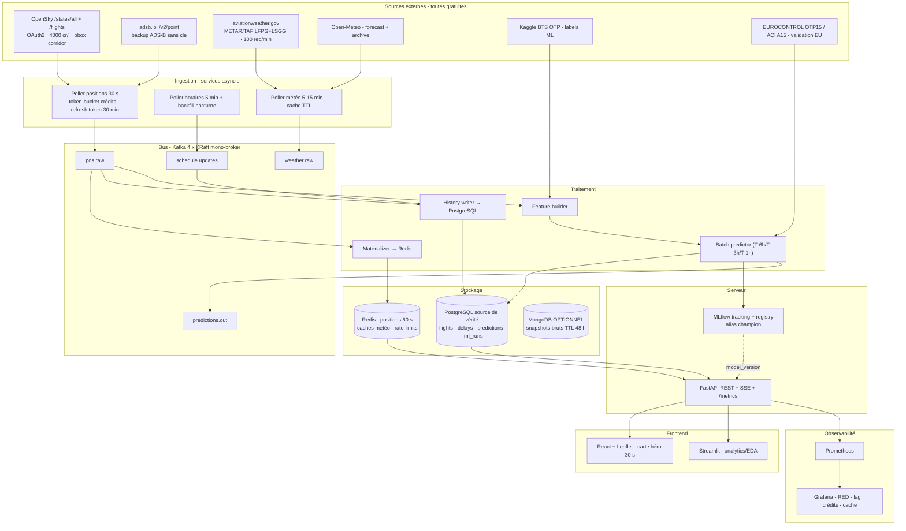
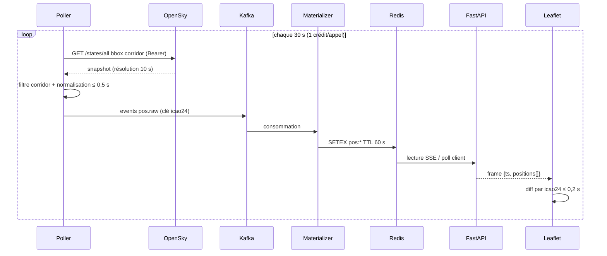
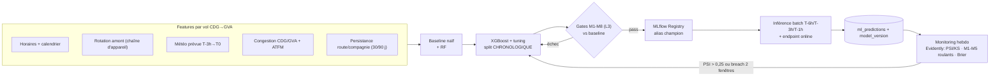

# L2 — Architecture & Components (high → medium level)

> **Level 2 of 3** — details the *how* : composants, données, interfaces, découpage en sprints.
> Prérequis : **G1 approuvé** ([L1](L1-strategy.md)). **Gate G2** avant de figer les seuils/tests de [L3](L3-metrics-and-acceptance.md).
> Chaque décision renvoie à une recherche sourcée : [`docs/research/`](../research/) (endpoints vérifiés en live le 2026-10-15).

---

## 1. Architecture globale



**Règles structurantes**

- **Une seule source de vérité durable** : PostgreSQL. Redis = cache chaud (jamais le seul exemplaire), Mongo = confort TTL (optionnel, cf. §6.3).
- **Bus derrière une interface `Bus`** : Kafka primary (mandaté par la stack), Redis Streams en fallback CI/dev, Redpanda si RAM trop juste — 1 seul conteneur Kafka 4.x KRaft (ZooKeeper supprimé).
- **Dégradation propre** : source coupée → API sert le dernier instantané avec `stale: true`, la carte ne devient jamais vide.

## 2. Flux temps réel (boucle 30 s)



**Budget latence** (cible K3 = rafraîchissement 30 s) : réponse source ≤ 2 s → parse ≤ 0,5 s → Kafka ≤ 0,2 s → Redis ≤ 0,05 s → push ≤ 0,5 s → rendu ≤ 0,2 s ⇒ **≈ 3,5 s de traitement en plus de la cadence 30 s** (marges larges).

## 3. Sources de données — décisions (détail : [`research/01`](../research/01-data-sources.md))

| Catégorie | **Primaire** | **Backup** | Coût | Risque maîtrisé par |
|---|---|---|---|---|
| Positions live | OpenSky `/states/all` (OAuth2 enregistré) | adsb.lol `/v2/point` ; snapshot cache `stale` | €0 | bbox corridor 22 sq° = **1 crédit** → 2 880/4 000 cr/j ✅ |
| Événements vol (arrivées/départs) | OpenSky `/flights/arrival\|departure?airport=LFPG\|LSGG` (batch T-1) | AeroAPI Personal ($5/mois de crédit) | €0 | batch nocturne, 404 = rien de neuf |
| Météo observée (METAR/TAF) | aviationweather.gov (sans clé) | CheckWX 200 j libres / AVWX | €0 | appels **serveur seulement** (pas de CORS), cache 15 min |
| Météo prévue (features) | Open-Meteo (AROME Météo-France, archive = jeu d'entraînement) | METAR observé | €0 | règle : **forecast, jamais observé**, au moment de l'émission (fuite de données) |
| Labels historiques | Kaggle BTS OTP (105 M vols 2010-2026, parquet) | BTS TranStats direct | €0 | **USA ≠ Europe** : features transférables, distributions non — calibrer vs EUROCONTROL |
| Réalité EU (vérité terrain) | EUROCONTROL OTP15 (xlsx) + ACI A15/D15 CDG | Eurostat agrégats | €0 | agrégats seulement → labels flight-level **auto-construits** (R2) |
| Horaires | snapshot OAG essai 14 j + médianes dérivées OpenSky | OpenFlights routes (fichiers GitHub) | €0 | pas de flux horaires gratuit long terme → DIY |
| Positions — piqûre de rappel | **TokenManager obligatoire** : OAuth2 client-credentials, expiration 30 min, refresh à marge 30 s → sinon 401 silencieux à H+0:30 | | | critère d'acceptation L3 §4 |

## 4. Ingestion — cadences & quotas (détail : [`research/03` §1](../research/03-realtime-architecture.md))

| Flux | Cadence | Coût unitaire | Total/jour | Verdict |
|---|---|---|---|---|
| Positions corridor (bbox 22 sq°) | 30 s | 1 crédit | 2 880 | ✅ standard 4 000 (marge 28 %) — **anonyme 400 = ❌** |
| Positions monde (1 850 sq°) | — | 4 crédits | 11 520 @30 s | ❌ → max 1 appel/86 s si besoin |
| `/flights/*` (bucket séparé) | 5 min | 4 crédits | 1 152 | ✅ |
| Météo | 5–15 min | 0 (NOAA/Open-Meteo) | ≈ 100 | ✅ |
| Contre-mesures | — | — | — | token-bucket (capacité = 90 % quota), backoff sur 429 + `X-Rate-Limit-Retry-After-Seconds`, jauge `X-Rate-Limit-Remaining` exportée à Prometheus |

- **Topics Kafka** : `pos.raw` (clé `icao24`, rétention 24–48 h) · `schedule.updates` · `weather.raw` · `predictions.out` · `deadletter`.
- **Consommateurs** : materializer → Redis · history writer → PostgreSQL (COPY batch) · feature builder → prédicteur.
- Charges : corridor ≈ 10 msg/s, Europe ≈ 83 msg/s @2 min → Kafka mono-broker largement au-dessus ; **les goulots d'étranglement seront crédits API et nombre de marqueurs navigateur, jamais le bus**.

## 5. Modèle de données

### 5.1 PostgreSQL — source de vérité (Étape 4 « relationnel »)

| Table | Clés principales | Notes |
|---|---|---|
| `airports` | `icao` PK, iata, nom, lat/lon, tz | dimension |
| `routes` | origine, destination, distance_km | ligne corridor LFPG→LSGG |
| `flights` | `(flight_date, flight_number)` unique, horaires TZ, `aircraft_reg`, statut | index partiel sur `flight_date` |
| `flight_observations` | `flight_id` FK, ts, lat, lon, alt, gs, track, vrate | rétention 7–30 j, corridor seul |
| `delays_history` | dep/arr delay, `delay_class` | fenêtres SQL pour stats route/horaire |
| `weather_observations` | station, ts, vent, précip, vis, `raw_jsonb` | corrélation retard × météo |
| `ml_predictions` | `flight_id`, `model_name:version`, `predicted_delay_min`, `proba`, `feature_snapshot` | **audit** ↔ MLflow |
| `ingestion_runs` | job, `last_success_ts`, records, `credits_remaining`, status | alimente la métrique de lag |
| `erasure_requests` + log décorrélation | icao24, motif, date, lignes affectées | preuve RGPD (§10) |

- **Jointures centrales** : flight × airport × weather × prediction — l'histoire « relationnel » du rendu.

### 5.2 Redis — chemin chaud (Étape 4 « cache »)

| Pattern | TTL | Rôle |
|---|---|---|
| `pos:{icao24}` / `pos:snapshot:{bbox}` | **60 s** (> cadence 30 s) | flux carte |
| `wx:{station}:{kind}` | 300–900 s + ±10 % jitter | cache météo anti-stampede |
| `cache:v1:{resource}:{params}` | 15–300 s `SETEX` | cache-aside API, `stale-while-revalidate` |
| `rl:opensky:states:{YYYYMMDD}` | 24 h | miroir du quota quotidien, soft-stop à 90 % |
| `rl:api:{ip}:{ep}:{min}` | 60 s | limitation de **notre** API publique |

### 5.3 MongoDB — optionnel (Étape 4 « NoSQL »)

- Usage si besoin de documents à schéma variable + TTL natif : `live_positions` (TTL 60 s), `raw_snapshots` (48 h), `weather_cache`.
- **Décision G2** : inclure si la grille NoSQL l'exige ; sinon PG `jsonb` + Redis suffisent (4 bases = lourdeur pour 3 étudiants). *Recommandé : inclure en léger (snapshots TTL), car demandé explicitement « relationnelle + NoSQL ».*

## 6. API — contrats (Étape 6, détail [`research/03` §3](../research/03-realtime-architecture.md))

| Endpoint | Backing | `Cache-Control` | Note |
|---|---|---|---|
| `GET /api/v1/flights?number=AF118&date=` | PG | `public, max-age=300` + ETag | recherche F1 |
| `GET /api/v1/airports/{code}/schedule?role=` | PG | `max-age=60` | aligné cadence upstream |
| `GET /api/v1/flights/{id}` | PG | `max-age=60` | fiche F2 + stats retard |
| `GET /api/v1/positions?bbox=` | Redis | `max-age=15, stale-while-revalidate=30` | payload `{as_of, stale}` |
| `GET /api/v1/predictions/{flight_id}` | PG | `max-age=60` | F4 + `model_name:version` |
| `GET /api/v1/stream/positions` | Redis → SSE | `no-store`, heartbeat 15 s | upgrade du polling 30 s |
| `GET /healthz` · `GET /metrics` | — | `no-store` | `/metrics` interne |

- **Transport carte** : v1 = **polling 30 s** (défaut & repli) ; v2 = **SSE** (reconnexion native, flux unidirectionnel suffit) ; WebSocket = non motivé.
- Pydantic v2, CORS restreint à l'origine frontend, `prometheus-fastapi-instrumentator` (1 ligne) pour les métriques L3 §2.4.

## 7. Frontend

| | Streamlit | React + Leaflet |
|---|---|---|
| Rôle | **analytics/EDA/ML ops** (outil interne, démos) | **carte héro F3** (marqueurs diffés, rotation `true_track`, clusters) |
| Refresh | `st.fragment(run_every="30s")` natif | SSE ou boucle fetch 30 s |
| Effort | 1–3 j | 1–2 sprints |
| Verdict | ✅ companion | ✅ carte ; **tiles CARTO** (5 M/mois non-commercial) — OSM dev seul |

- **Fallback effort (R5)** : MVP carte en Streamlit semaine 1 → carte React à partir du sprint 2 si le temps le permet ; le contrat API reste identique.

## 8. Pipeline ML (Étape 5 — détail : [`research/02`](../research/02-ml-delay-prediction.md))



- **Choix justifié** : XGBoost primaire (ablation FlightSense : AUC 0,732 → **0,879** avec rotation + météo), RF + naïf comme baselines ; deep learning écarté sur données tabulaires (coût/數據 sans gain démontré) — *veille technologique Étape 2*.
- **Garde-fous** : split chronologique (jamais CV aléatoire), aucune colonne post-départ en features, météo **prévue** à l'émission, features de rotation depuis la **jambe précédente uniquement**.
- **Retrain** : mensuel (périodique) comme colonne vertébrale — étude 2026 (3 933 runs) : le retrain périodique bat les politiques réactives ; PSI/mauvais gates = **override d'urgence**.
- **Batch + online hybride** : batch écrit la table quotidienne (map + dashboard lisent ça), endpoint online recalcule à la demande ; les deux estampillent `model_version`.

## 9. Topologie de déploiement (Étapes 6–7 — détail [`research/03` §6](../research/03-realtime-architecture.md))

| Tier | Setup | Coût | Quand |
|---|---|---|---|
| 0 — dev quotidien | `docker compose` profils (`api`, `ingest`, `postgres`, `redis` sans Kafka) | €0 | toujours |
| 1 — démo/gradée **recommandé** | 1 VM EU (Oracle Always Free Arm ou VPS €4–7), Caddy TLS, GH Actions SSH deploy, `restart: unless-stopped`, `pg_dump` quotidien | €0–7/mois | Étape 7 |
| 2 — PaaS partiel | Streamlit Cloud (analytics) / HF Spaces (API démo) | €0 | bonus, pas le stack complet (plus de free tier complet : Fly l'a supprimé) |

- **Profils compose** : `full` (Kafka+Mongo+MLflow+predict) vs dev léger → démarrage < 6 Go RAM ≈ tout laptop 16 Go.
- **CI (GitHub Actions)** : ruff + pytest (+ services postgres/redis/kafka) → build images GHCR → `compose config` → deploy sur `main`. Repo public = minutes illimitées.
- **Hébergement EU-only** = aussi l'engagement RGPD §10.

## 10. Couche conformité & RSE (détail : [`research/04`](../research/04-compliance-rse.md))

```mermaid
flowchart TD
    A[Trajectoire ADS-B icao24] --> B{Lien personne physique ?<br/>jet privé / registre}
    B --|non - ligne régulière| C[Pas de donnée perso en pratique]
    B --|oui - identification indirecte| D["Donnée perso (préc. IMY DI-2021-3397)"]
    D --> E["Base légale = intérêt légitime 6(1)(f)<br/>test de balancement documenté (CNIL)<br/>PAS de consentement"]
    E --> F["Safeguards :<br/>1 mentions RGPD (intérêt énoncé)<br/>2 effacement propriétaires privés ≤ 48 h<br/>3 décorrélation 30 j de l'historique<br/>4 logs hébergés en UE"]
    F --> G{"AIPD ? Critères CNIL ≥ 2<br/>+ FR : localisation large échelle"}
    G --> H["AIPD-lite (CNIL PIA) datée<br/>AVANT déploiement"]
```

- **30 j décorrélation** : mapping `icao24↔immat` dans une table **séparée** ; job nocturne supprime/remplace l'`icao24` sur l'historique > 30 j ; journal de preuves (date, lignes).
- **Disclaimer couverture** (modèle FR24 ToS 14.6) : « couverture non exhaustive (avions d'État, militaires, hors portée)… titre informatif, pas d'usage opérationnel… prédictions = estimations pédagogiques ».
- **CO₂ (F6)** : primaire = Google TIM API (gratuit, par cabine) → fallback = facteurs ICAO ICEC v13.1 (LF Europe 82,3 %, +50 km GCD) ; toujours libellé **« estimation » + méthode + version + date** (loi climat : allégations fondées).
- **WCAG 2.2 AA** volontaire : retard = couleur **+ icône + texte**, `aria-live` pour les mises à jour, pause du refresh, `prefers-reduced-motion`, cibles ≥ 24 px.
- **Écoconception RGESN** : cache météo (requêtes upstream), debounce recherche, toggle cadence d'affichage, dark par défaut (sans claim « dark = vert »), budget CPU d'entraînement mesuré → bilan NumÉcoDiag pour le jury.

## 11. Découpage en sprints (contrat Étape → livrable)

| Sprint | Jalon | Contenu (sections de ce plan) | Preuve de fin |
|---|---|---|---|
| S1 | Étape 0 | cadrage, ce plan v1, dépôt/CI de base | G1 signé |
| S2–S4 | **Étape 1** | 1er ingest corridor + rapport sources (déjà amorcé : [`research/01`](../research/01-data-sources.md)) | échantillons + rapport |
| S5–S7 | **Étape 2** | SWOT finalisé, veille = synthèse research/02–04 | CdC + veille |
| S8–S9 | **Étape 3** | KPIs formels + roadmap = L3 validé | **G3 signé** |
| S10–S11 | **Étape 4** | §5 PG+Redis+Mongo, §4 ingestion, topics Kafka | pipelines verts + données qui coulent |
| S12–S13 | **Étape 5** | §8 features, XGBoost, MLflow, drift, gates L3 §2.1 | gates M1–M8 vs baseline |
| S14–S15 | **Étape 6** | §6 API, §7 carte, §9 compose+CI | endpoints + carte 30 s en dev |
| S16–S18 | **Étape 7** | §9 tier 1, §10 conformité finale, Prometheus/Grafana | dashboards + alertes en prod |
| Année 2 | Soutenance | démo + récit des étapes techniques | tous gates L3 §6 verts |

## 12. Checklist de gate G2 — avant de figer L3

- [ ] Architecture globale + boucle 30 s : budget latence accepté
- [ ] Stack sources (primaire/backup par catégorie) validé — incl. fallback adsb.lol et règle « forecast not observed »
- [ ] Cadences & budget quotas OpenSky validés (compte enregistré à créer en S1)
- [ ] Schéma PG assumé ; décision **Mongo oui/non** tranchée (§5.3)
- [ ] Contrats API (7 endpoints) + transport (poll → SSE) validés
- [ ] Choix frontend (carte React+Leaflet, Streamlit companion) ou fallback assumé
- [ ] Pipeline ML (XGBoost + chronologie + batch/online + retrain mensuel) validé
- [ ] Déploiement tier 0/1 + CI validés ; conformité §10 : 5 engagements assumés
- [ ] Découpage sprints ↔ Étapes réaliste pour l'équipe (§11)

**Suite** → [L3 — Métriques & acceptation (medium → low)](L3-metrics-and-acceptance.md)