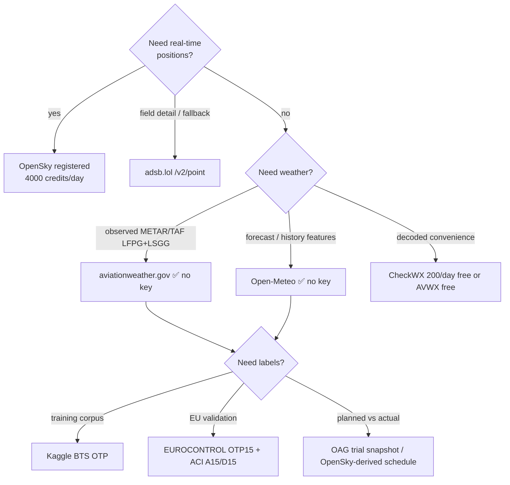

# Étape 1 — Data Sources Research Report
## « Plateforme d'intelligence aéronautique » LFPG (Paris CDG) → LSGG (Genève)

**Method note:** every claim below carries its source URL. Items marked ✅ were **verified live on 2026-10-15** by direct API calls from this machine; items not machine-verifiable are marked `[INFERENCE]`. Scope: data sources only (ML modelling, architecture and compliance are covered by other agents).

---

## 0. Big picture

```mermaid
flowchart LR
    subgraph ADSB["Real-time ADS-B (positions)"]
        OS[OpenSky /states/all<br/>anon OK ✅]

[331 more lines in resource. Use :139 to continue]
        AL[adsb.lol /v2/point ✅]
        AF[adsb.fi opendata ✅ sample]
        ALV[airplanes.live ❌ blocked 2026-10-15]
    end
    subgraph WX["Weather (METAR/TAF + NWP)"]
        AWC[aviationweather.gov<br/>METAR/TAF LFPG+LSGG ✅]
        OM[Open-Meteo hourly ✅ no key]
        CV[CheckWX / AVWX decoded]
    end
    subgraph HIST["Historical delays"]
        KAG[Kaggle/BTS OTP 2010-2026]
        EC[EUROCONTROL OTP15 xlsx ✅ link]
        ACI[ACI-APN A15/D15 Europe]
    end
    subgraph SCH["Schedules (planned)"]
        OAG[OAG 14-day dev trial ✅]
        OF[OpenFlights routes only<br/>airports.dat ✅ 200]
    end
    OS --> P[Kafka → Postgres/Mongo<br/>Redis live cache]
    AL --> P
    AWC --> P
    OM --> P
    KAG --> P
    EC --> P
    OAG --> P
    P --> APP[Map · Delay prediction · Grafana]
```

---

## 1. Real-time ADS-B

### 1.1 OpenSky Network — primary source ✅

**Docs (all facts below):** https://openskynetwork.github.io/opensky-api/rest.html (v1.4.0)

**Endpoints** (root `https://opensky-network.org/api`):

| Endpoint | Params | Notes |
|---|---|---|
| `GET /states/all` | `time`, `icao24` (repeatable), `lamin/lomin/lamax/lomax`, `extended=1` | live state vectors, rate-limited by credits |
| `GET /states/own` | `time`, `icao24`, `serials` | own receivers only, **no credit cost**, auth required (403 without) |
| `GET /flights/all` | `begin`,`end` (≤ 2 h window) | flights in interval; 404 if none |
| `GET /flights/aircraft` | `icao24`,`begin`,`end` (≤ 2 days) | updated nightly (T-1 and earlier only) |
| `GET /flights/arrival` | `airport` (ICAO), `begin`,`end` (≤ 2 days) | nightly batch → e.g. `airport=LFPG` |
| `GET /flights/departure` | `airport`,`begin`,`end` (doc: window must cover > 2 days UTC) | nightly batch |
| `GET /tracks/all` | `icao24`, `time` (0 = live) | **experimental**; ≤ 30 days back; waypoint rules: ≥ every 15 min, > 2.5° turn, > 100 m alt change, on-ground flip |

**Auth:** OAuth2 **client-credentials only** — "Basic authentication with username and password is no longer accepted" (the GitHub Python client README notes this became effective 2026-03-18, https://github.com/opensky-network/opensky-api/tree/master/python). Token endpoint: `https://auth.opensky-network.org/auth/realms/opensky-network/protocol/openid-connect/token`, tokens expire after **30 min**, pass as `Authorization: Bearer`. Anonymous access **also works** ✅ (live test returned data with no auth header).

**Quotas (credits in 3 independent buckets: `/states/*`, `/tracks/*`, `/flights/*`):**

| Tier | Credits/bucket | Refill |
|---|---|---|
| Anonymous (IP-bucketed) | 400 | daily |
| Standard user | 4,000 | daily |
| Active feeder (≥30 % uptime/mo) | 8,000 | daily |
| Licensed user | 14,400 | hourly |

- `/states/all` cost by bbox area: ≤ 25 sq° → **1 credit**; 25–100 → 2; 100–400 → 3; > 400/global → 4.
- `/flights/*` & `/tracks/*` cost by calendar-day partitions: live/< 24 h → **4 credits**; 1–2 days → 30; then 60×N … 960×N.
- Exhaustion → `429` + `X-Rate-Limit-Remaining` / `X-Rate-Limit-Retry-After-Seconds`.
- Anonymous: `time` param **ignored**, 10 s resolution; authenticated: 1 h history, 5 s resolution. History > 1 h → Trino/MinIO interface (https://openskynetwork.github.io/opensky-api/trino.html).

**State-vector fields (17/18 columns, positional array):** `icao24, callsign, origin_country, time_position, last_contact, longitude, latitude, baro_altitude (m), on_ground, velocity (m/s), true_track (°), vertical_rate (m/s), sensors, geo_altitude, squawk, spi, position_source (0 ADS-B/1 ASTERIX/2 MLAT/3 FLARM), category` (extended=1). Full spec incl. aircraft-category enum: rest.html#response.

**Live sample** ✅ `GET /states/all?lamin=46.2&lomin=5.0&lamax=47.4&lomax=6.8` (Alps corridor, 3.24 sq° = 1 credit) → **24 states**, e.g.:
`['440030', 'EJU85JE ', ' Austria', 1792069066, 1792069066, 6.0535, 46.6974, 10363.2, False, 240.49, 297.94, 0, None, 10919.46, '5747', False, 0]`

**Coverage CDG–GVA corridor:** the corridor (~600 km) sits entirely in OpenSky's densest region; ~2,000 receivers "mostly concentrated in Europe and the US" (https://en.wikipedia.org/wiki/OpenSky_Network); official coverage map: https://opensky-network.org/about/network (page returned 403 to our reader, map exists). Empirical: small bbox queries returned live traffic over France/Switzerland ✅ — coverage adequate for the route. Ground/density caveat for very low altitudes over remote terrain `[INFERENCE]`.

### 1.2 adsb.lol — best free ADS-B backup ✅

- Docs/OpenAPI: https://api.adsb.lol/docs · spec https://api.adsb.lol/api/openapi.json
- Endpoints: `GET /v2/point/{lat}/{lon}/{radius}` (≤ 250 nm), `/v2/closest/{lat}/{lon}/{r}`, `/v2/hex/{hex}`, `/v2/callsign/{cs}`, `/v2/registration/{reg}`, `/v2/squawk/{sqk}`, `/v2/type/{type}`, plus `/v2/mil`, `/v2/pia`, `/v2/ladd`.
- Terms (quoted from docs): "You can use the API for free. In the future, you will require an API key which you can get by feeding to adsb.lol… contact me for production"; license **ODbL**. No published numeric rate limit `[INFERENCE: cache and stay modest]`.
- Live sample ✅ `GET /v2/point/49.0/2.5/50` → 73 aircraft; record fields: `hex, type, flight, r (reg), t (type), alt_baro, alt_geom, gs, ias, tas, mach, wd, ws, oat, tat, track, track_rate, roll, mag_heading, true_heading, baro_rate, geom_rate, squawk, emergency, category, nav_qnh, nav_altitude_mcp, lat, lon, nic, rc, seen_pos, version, nic_baro, nac_p, nac_v, sil, sil_type, gva, sda, alert, spi, mlat[], tisb[], messages, seen, rssi, dst, dir`.

### 1.3 adsb.fi — free mirror ✅ (partial)

- Open data API in readsb format, e.g. https://opendata.adsb.fi/api/v2/mil returned live JSON ✅ with fields `alt_baro, gs, track, baro_rate, squawk, lat, lon, nic, rc, seen_pos, alert, spi, mlat[]`; map https://globe.adsb.fi/. No formal docs page located in this pass → endpoint names (`/api/v2/point/...`) follow adsb.lol's pattern `[INFERENCE]`. Same ODbL-style open-data spirit.

### 1.4 airplanes.live — currently unusable anonymously ❌

- Claimed guide (search-indexed content of https://airplanes.live/api-guide): base `https://api.airplanes.live/v2/`, "does not currently require a feeder [key]", **non-commercial use, no SLA/no uptime guarantee**; field reference: https://airplanes.live/rest-api-adsb-data-field-descriptions.
- ❌ **Live test 2026-10-15:** `GET /v2/point/46.2/6.1/50` returned `{"error": "Please contact us at contact@airplanes.live. Your email MUST include any links, a description of the project…"}` → effectively requires operator approval now. **Do not build on it.**

### 1.5 AvioADSB — niche free tier (secondary evidence)

Per https://avioadsb.org/docs/api (search-indexed): Anonymous — no key, 1 req/10 s, 100 req/day (UTC), radius ≤ 100 nm; "Contributor" (key + active feeder) — 1 req/s. `[INFERENCE: verify page before relying]`.

### 1.6 AviationStack — flight-status API (not ADS-B)

Source: https://aviationstack.com/pricing ✅ (full pricing table retrieved), docs https://docs.apilayer.com/aviationstack/docs/api-documentation ✅ (HTTP 200).

| Plan | Price | Requests | Notable |
|---|---|---|---|
| **Free** | $0 | **100/month** | real-time flights, HTTPS, **non-commercial**, no support; **no historical, no routes, no Flight Schedules** |
| Basic | $49.99/mo ($44.99 yr) | 10,000/mo | + historical (3-month sliding window), routes, autocomplete, **Flight Schedules, Future Flight** |
| Professional | $149.99/mo | 50,000/mo | |
| Business | $499.99/mo | 250,000/mo | |

- Real-time lag "30–60 seconds"; historical = last 3 months sliding window (pricing FAQ). Free tier = **~3 calls/day → fine for demos, useless for streaming**. Auth: API key (apilayer `access_key` param/header `[INFERENCE: exact param per apilayer convention]`).

### 1.7 FlightAware AeroAPI — richest status/itinerary API, small free credit

Sources: https://www.flightaware.com/commercial/aeroapi · OpenAPI https://www.flightaware.com/commercial/aeroapi/resources/aeroapi-openapi.yml (v4.17.1, base `https://aeroapi.flightaware.com/aeroapi`) · https://www.flightaware.com/commercial/data

- 60+ REST/JSON endpoints; historical data from **2011-01-01** onward (product page).
- **Personal tier: no monthly minimum; per-query usage fees with up to $5/month free credit ($10/month for ADS-B feeder hosts)** (product page + staff confirmation https://discussions.flightaware.com/t/aeroapi-any-free-tier/100571).
- Per-query pricing "as low as $0.002" (commercial/data page); a user reports $0.005/call for `flights/{ident}` (https://discussions.flightaware.com/t/aeroapi-billing-actual-vs-documentation/99742) → **≈ 1,000–2,500 calls/month free** `[INFERENCE: endpoint-dependent]`.
- Commercial access reported "starts at $100/month" — secondary source: https://avinational.com/flightaware-pricing-commercial-api-and-enterprise-flight-data-costs-for-businesses `[INFERENCE]`.
- License restrictions (Personal = no redistribution of derivative works): https://www.flightaware.com/commercial/aeroapi/AeroAPI_Personal_License_Jul2026_v2.pdf → check before storing/displaying raw data (compliance agent owns details).

---

## 2. Weather (delay-prediction-relevant fields: wind/gusts, visibility, ceilings, precipitation type, thunderstorms, snow)

### 2.1 NOAA Aviation Weather Center Data API — primary METAR/TAF ✅ (free, no key)


[211 more lines in resource. Use :259 to continue]
Docs: https://aviationweather.gov/data/api · OpenAPI: https://aviationweather.gov/data/schema/openapi.yaml

- `GET /api/data/metar?ids=LFPG,LSGG&format=json` ✅ **live**, worldwide, 30 days history, formats raw/JSON/GeoJSON/CSV/XML/IWXXM.
- `GET /api/data/taf?ids=LFPG&format=json` ✅ **live**.
- **Limits:** no key; custom `User-Agent` recommended; **100 requests/minute**; max **400 entries/query**; no CORS; `429` on excess. Bulk: cache files `metars.cache.csv.gz` (every 1 min), `tafs.cache.xml.gz` (10 min).
- **Live METAR sample** ✅: `{ "icaoId":"LFPG", "obsTime":1792067400, "reportTime":"2026-10-15T12:30:00Z", "temp":22, "dewp":14, "wdir":180, "wspd":8, "visib":"6+", "altim":1024, "rawOb":"METAR LFPG 151230Z AUTO 18008KT 110V220 CAVOK 22/14 Q1024 NOSIG", "lat":49.015, "lon":2.534, "elev":107, "cover":"CAVOK", "clouds":[], "fltCat":"VFR" }` (LSGG identical shape: Q1027, `fltCat` VFR).
- **Live TAF sample** ✅ fields: `bulletinTime, issueTime, validTimeFrom/To, rawTAF, fcsts[]` with per-segment `fcstChange (TEMPO/BECMG/PROBxx), probability, wdir, wspd, wgst, visib, wxString, clouds[{cover, base, type}]`.
- Delay-relevant extract: `wspd/wgst`, `visib`, `clouds[].base` (ceiling), `wxString` (RA/SN/TS/FG), `fltCat` (VFR/MVFR/IFR/LIFR), `altim` (QNH).

### 2.2 Open-Meteo — free NWP/nowcast, no key ✅

Docs: https://open-meteo.com/en/docs ✅ (retrieved in full)

- Free **without API key for non-commercial use**; `apikey` + `customer-` host prefix only for commercial (docs' `apikey` row; pricing https://open-meteo.com/en/pricing).
- Hourly delay features: `wind_speed_10m, wind_direction_10m, wind_gusts_10m, visibility, precipitation, rain, showers, snowfall, snow_depth, weather_code (WMO incl. 95/96/99 thunderstorm), cloud_cover_low/mid/high, cape, precipitation_probability, pressure_msl`; `minutely_15` for nowcasting (AROME/HRRR/ICON-D2; `visibility`, `wind_gusts_10m`, `lightning_potential` on ICON-D2).
- History: `past_days` (0–92), **Historical Forecast API** (as-issued runs "useful for … training ML models") and Archive API for multi-year training sets.
- European relevance: **AROME (Météo-France, 1–25 km)** selected for France by "best match" model selection ✅.
- Live sample ✅ LFPG (49.0097, 2.5479): `current: {temperature_2m: 21.0, precipitation: 0.0, weather_code: 2, wind_gusts_10m: 22.3}`, hourly `visibility: 34640.0 m, weather_code: 1, wind_speed_10m: 4.8, wind_gusts_10m: 10.1`.

### 2.3 AVWX (api.avwx.rest) — decoded reports, token required ✅

Sources: https://avwx.rest/ (homepage) · https://support.avwx.rest/api · https://support.avwx.rest/tiers · https://support.avwx.rest/token

- **Auth:** ✅ live — anonymous call `GET https://avwx.rest/api/metar/LFPG` → `{"meta":{"validation_error":"You are missing the \"Authorization\" header or \"token\" parameter…"}}`; with a bad `Authorization: Bearer …` → "Your auth token is not allowed to access this resource". So: **`Authorization` header or `token` query param**.
- Pricing: "three pricing tiers: **hobby, pro, enterprise**. **The basic METAR and TAF parsing services are free**" (homepage); exact prices/call limits only on the account portal (https://account.avwx.rest). Daily quota model: **429 for the rest of the day, reset 00:00Z**, optional overage billing; paid plans include a separate dev token capped at 4k calls/day (support pages).
- Response shape (sample payload returned by the API ✅): parsed `altimeter{repr,value}, clouds[{altitude, direction, modifier, repr, type}], …` (METAR tokenized into elements + flight-rules).
- Note: docs Apiary URL (https://avwx.docs.apiary.io) returned **502** at test time; support site works.

### 2.4 CheckWX — decoded METAR/TAF, cheap tier

Sources: https://www.checkwxapi.com/documentation/introduction ✅ · /documentation/metar ✅ · /pricing ✅ · /news ✅

- **Auth:** `X-API-Key: YOUR_API_KEY` header or `?x-api-key=` (docs). Base `https://api.checkwx.com/`, URL-versioned `/v2/...`.
- Endpoints: `GET /v2/metar/{icao}` (+ `/raw`, `/short`, `/decoded`, `/nearest`, `/radius/{r}`); max **25 ICAOs per request** (comma-joined = 1 call); same pattern for TAF; response envelope `{results, data:[…]}`. Decoded fields (docs example ✅): `icao, raw_text, observed, report.type, clouds[{code, feet, meters}], dewpoint, flight_category, temperature, humidity, station{icao,iata,name,geometry,location}, pressure{hg,mb}, visibility{miles,meters,text}, wind{degrees, speed{kts,mph,kph,mps}, direction}, remarks[]`.
- **Quotas:** **Trial 200 requests/day free**; **Starter 3,000/day = $1/month since 2026-06-01** (news post: free Starter discontinued, non-upgraders moved to Trial); Developer 50,000/day; Business 250,000/day; Enterprise 500,000/day (paid tier prices JS-rendered, not extracted). `429` on excess, counter resets **00:00 UTC**; official caching advice: METAR/TAF ≥ 15 min, STATION ≥ 24 h; aggressive polling can get accounts disabled.

---

## 3. Historical delays

### 3.1 Kaggle / US DOT BTS (the only flight-level, delay-labelled open corpus)

| Dataset | Size / span | Key content | URL |
|---|---|---|---|
| 2015 Flight Delays & Cancellations (US DOT) | 2015, ~5.8M rows | the classic schema: sched/actual dep & arr, `DEPARTURE_DELAY, ARRIVAL_DELAY, TAXI_OUT/WHEELS_OFF/AIR_TIME, CANCELLED, DIVERTED, CANCELLATION_REASON` + cause splits `AIR_SYSTEM_DELAY, SECURITY_DELAY, AIRLINE_DELAY, LATE_AIRCRAFT_DELAY, WEATHER_DELAY` `[INFERENCE: exact column list — Kaggle pages are JS-rendered, page not machine-readable in this pass]` | https://www.kaggle.com/datasets/usdot/flight-delays |
| Flight Data 2024 (hrishitpatil) | **7M+ rows, 35 columns** ✅ snippet | scheduled & actual times, delays, cancellations, diversions, distance | https://www.kaggle.com/datasets/hrishitpatil/flight-data-2024 |
| US Flight On-Time Performance 2010–2026 | **105M+ flights, 17 yrs, Parquet** ✅ meta | flight-level + aggregate & dimension layers | https://www.kaggle.com/datasets/dianatofficial/us-flight-on-time-performance-2010-2026 |
| US Flight Delays 2025 (BTS OTP) | 12 monthly files, 7M+ flights, **uniform 40-column schema** ✅ snippet | sourced from transtats.bts.gov | https://www.kaggle.com/datasets/a7madmostafa/us-flight-delays-2025-bts-on-time-performance |
| Flight Delay Dataset 2018–2024 | 6 years ✅ | delay labels per flight | https://www.kaggle.com/datasets/shubhamsingh42/flight-delay-dataset-2018-2024 |
| Global Flight Disruption Index 2020–2026 | daily delays, cancellations, causes, 106-airport registry ✅ snippet | disruption causes (European coverage unverified `[INFERENCE]`) | https://www.kaggle.com/datasets/zkskhurram/global-flight-disruption-index-20202026 |
| Aeolus (research) | multi-modal delay dataset | arXiv 2510.26616 | https://arxiv.org/html/2510.26616v2 |

- Primary source behind all of them: **BTS TranStats** — on-time/delay-cause tables https://www.transtats.bts.gov/ot_delay/ot_delaycause1.asp ✅ search hit; field dictionary https://www.transtats.bts.gov/Fields.asp; delay-cause definitions (carrier / weather / NAS / security / late aircraft) linked as "Delay Cause Definition" from TranStats. Free, no key (CSV downloads; Kaggle mirrors avoid scraping).
- Access: Kaggle account + API token (free); `kaggle` CLI or direct dataset download.

### 3.2 Europe / CDG

| Source | Grain | Content | URL |
|---|---|---|---|
| **EUROCONTROL (Network Manager data, PRU portal)** | network/state/**airport aggregates** | **OTP15 punctuality**, % operated schedules, ATFM delay; downloadable workbooks: `Network_Punctuality.xlsx`, `Stakeholder_Punctuality.xlsx` (state/airport) ✅ links retrieved from portal | https://ansperformance.eu/punctuality/ ✅ · dashboards https://www.eurocontrol.int/Economics/DailyPunctuality-Airports.html |
| **ACI Europe / Airport Council APN** | monthly per airport (incl. CDG) | **A15/D15 arrival & departure punctuality** for all European airports; monthly + annual reports ✅ (e.g. Annual 2024 id=3381; March 2026 id=3855) | https://www.aci-europe.org/component/attachments/attachments.html?id=3381 |
| EUROCONTROL data assets | weekly/daily PDFs & snapshots | ATFM delay minutes/day, punctuality % | https://www.eurocontrol.int/library · https://www.eurocontrol.int/our-data |
| Eurostat `avia_*` | monthly aggregates | commercial flights by schedule type | https://ec.europa.eu/eurostat/databrowser/view/avia_paoac/default/table |
| CDG-specific research | flight-level off-block delay model at CDG | methodology paper (data itself not public) | https://www.sciencedirect.com/science/article/pii/S0169023X24000272 |

**⚠️ Key gap:** there is **no open flight-level European delay dataset** comparable to BTS OTP `[INFERENCE]` — EU delay labels must be assembled (schedules vs actuals from ADS-B/ADS-B-derived flight phases + EUROCONTROL/ACI aggregates for validation).

**US-vs-Europe transferability caveat:** BTS delay causes are defined against US operational concepts (A15 gate-based OTP, "NAS delay" = US ATC flow programs, no ATFM equivalent). European delay structure is dominated by **ATFM network-manager slots** and EU airport collaborative decision-making; a model trained on US `weather_delay`/`airline_delay` splits learns US airline/ATC behaviour. Transferable: feature engineering (time-of-day, weekday, season, weather joins, lagged airport delays). Not transferable without recalibration: absolute delay distributions and cause attributions → validate against EUROCONTROL OTP15 and ACI A15/D15 on the actual CDG–LSGG route.

---

## 4. Schedules (planned vs actual)

| Source | What it gives | Cost/limits | URL |
|---|---|---|---|
| **OAG Schedules** | 900+ airlines, updated **every 15 min**, 20+ yrs history, 1 yr ahead; schedules + status + connections | **14-day free dev trial**, then commercial (quote) | https://www.oag.com/airline-schedules-data · portal https://developers.oag.com/ ✅ HTTP 200 |
| **AviationStack "Flight Schedules"/Future Flight** | planned times by flight number/date | **paid tiers only** (Basic+) ✅ pricing table | https://aviationstack.com/pricing |
| **AeroAPI** | 60+ endpoints incl. flight status with scheduled/estimated/actual times, history from 2011 | Personal tier ~$5/mo free credit | https://www.flightaware.com/commercial/aeroapi |
| **OpenFlights** | airports.dat / airlines.dat / routes.dat only — **no timetables**; ODbL; "unmaintained" (community list) | free raw files (both `airports.dat`, `routes.dat` verified **HTTP 200** ✅); note **`openflights.org/data.html` now returns 404** ✅ → use GitHub raw | https://raw.githubusercontent.com/jpatokal/openflights/master/data/airports.dat · https://github.com/lucianosrp/open-source-aviation |
| **Pragmatic DIY** | planned times = OAG trial snapshot, or derive per-flight-number median scheduled times from OpenSky `/flights/departure` history | free | https://openskynetwork.github.io/opensky-api/rest.html |

---

## 5. Rate limits, auth & student-scale cost — summary table

| Source | Auth | Free quota / rate limit | On excess | Est. cost @ student scale (per month) |
|---|---|---|---|---|
| OpenSky `/states/all` (anon) | none (IP-bucketed) | 400 credits/**day** (bbox ≤ 25 sq° = 1 credit), 10 s resolution, no `time` | `429` + Retry-After | **€0** |
| OpenSky `/states/all` + `/flights/*` (registered) | OAuth2 client-credentials Bearer (30 min token) | 4,000 credits/**day per bucket** (states/tracks/flights); 5 s res, 1 h history | `429` | **€0** (free account) |
| OpenSky `/states/own` | Bearer | unlimited (own receivers only) | — | n/a |
| adsb.lol | none today (key planned for future; ODbL) | no published number — "free to use"; contact for production | unknown `[INFERENCE]` | **€0** |
| adsb.fi (opendata) | none | not published `[INFERENCE]` | unknown | **€0** |
| airplanes.live | contact-permission (observed) | ❌ blocked anonymously 2026-10-15 | error JSON | — |
| AvioADSB | none (anon tier) | 1 req/10 s, 100/day, ≤ 100 nm (secondary source) `[INFERENCE]` | unknown | **€0** |
| AviationStack | API key | **100 req/month** (free, non-commercial, real-time only) | blocks at quota | **€0** (too small for streaming) |
| FlightAware AeroAPI | API key (Bearer) | Personal: no minimum, **$5/mo free query credit** ($10 feeders), ≈$0.002–0.005/query | billed per query beyond credit | **€0–5** |
| aviationweather.gov | none; custom `User-Agent` | **100 req/min**, ≤ 400 results/query, 30-day window, no CORS | `429` | **€0** |
| Open-Meteo | none (non-commercial); key only for commercial | no key required; fair-use (no published number) `[INFERENCE]` | throttling | **€0** |
| AVWX | `Authorization` header or `token` param (✅ verified) | free plan: basic METAR/TAF parsing; daily call limit (value on account portal) | `429` till 00:00Z | **€0** |
| CheckWX Trial | `X-API-Key` / `?x-api-key` | **200 req/day** | `429`, reset 00:00 UTC | **€0** |
| CheckWX Starter | same | **3,000 req/day** | `429` | **$1** |
| Kaggle (BTS mirrors) | account + API token | free downloads | — | **€0** |
| EUROCONTROL xlsx / ACI PDFs | none | free downloads | — | **€0** |
| OAG | dev portal account | **14-day trial** (schedules, status, connections) | then commercial | **€0 short-term**; paid thereafter (quote) |

**Realistic total: €0–6/month** for the whole platform.

---

## 6. Sample-record sketches (field lists per source)

**A. OpenSky state vector** (positional; ✅ live):
```
time: 1792069067
states[0] = ["398c4e","SAMU71  ","France",1792069063,1792069063,
             5.2213,46.7118,350.52,false,68.75,103.41,-0.33,null,502.92,null,false,0]
# icao24 | callsign | origin_country | time_position | last_contact | lon | lat |
# baro_altitude(m) | on_ground | velocity(m/s) | true_track(°) | vertical_rate(m/s) |
# sensors | geo_altitude(m) | squawk | spi | position_source
```

[91 more lines in resource. Use :379 to continue]

**B. OpenSky track waypoint** (rest.html): `[time(s), latitude, longitude, baro_altitude, true_track, on_ground]`

**C. adsb.lol / adsb.fi aircraft (readsb `ac[]`)** (✅ live):
```
{ hex:"484445", flight:"KLM765  ", r:"PH-AOF", t:"A332", alt_baro:33000, alt_geom:34750,
  gs:469.2, ias:295, tas:486, mach:0.828, wd:274, ws:22, track:232.45, baro_rate:0,
  squawk:"2102", category:"A5", lat:48.829154, lon:1.351174, nic:8, rc:186,
  seen_pos:0.222, nac_p:9, sil:3, mlat:[], tisb:[], messages:46846, rssi:-14.2,
  dst:46.38, dir:257.7 }
```

**D. METAR JSON (aviationweather.gov)** (✅ live): `icaoId, receiptTime, obsTime, reportTime, temp, dewp, wdir, wspd, visib, altim, qcField, metarType, rawOb, lat, lon, elev, name, cover, clouds[], fltCat`

**E. TAF JSON (aviationweather.gov)** (✅ live): `bulletinTime, issueTime, validTimeFrom/To, rawTAF, mostRecent, lat/lon, fcsts[{timeFrom,timeTo,timeBec,fcstChange,probability,wdir,wspd,wgst,visib,altim,vertVis,wxString,clouds[{cover,base,type}]}]`

**F. CheckWX decoded** (docs example ✅): `icao, raw_text, observed, report.type/status, clouds[{code,feet,meters,text}], dewpoint{celsius,fahrenheit}, flight_category, temperature, humidity, station{icao,iata,name,geometry.coordinates,location}, pressure{hg,mb}, visibility{miles,meters,text}, wind{degrees,speed{kts,mph,kph,mps},direction}, remarks[]`

**G. Open-Meteo** (✅ live): `{latitude, longitude, elevation, generationtime_ms, utc_offset_seconds, timezone, current{time, interval, temperature_2m, precipitation, weather_code, wind_gusts_10m}, hourly{time[], wind_speed_10m[], wind_gusts_10m[], wind_direction_10m[], visibility[], precipitation[], snowfall[], weather_code[], cloud_cover_low[], cape[]}, hourly_units{}}`

**H. BTS/Kaggle OTP row** `[INFERENCE: standard BTS on-time schema]`: `FL_DATE, AIRLINE, FLIGHT_NUMBER, ORIGIN_AIRPORT, DEST_AIRPORT, SCHED_DEPARTURE, DEPARTURE_TIME, DEPARTURE_DELAY, TAXI_OUT, WHEELS_OFF, SCHEDULED_TIME, AIR_TIME, DISTANCE, SCHEDULED_ARRIVAL, ARRIVAL_TIME, ARRIVAL_DELAY, CANCELLED, DIVERTED, CANCELLATION_REASON, AIR_SYSTEM_DELAY, SECURITY_DELAY, AIRLINE_DELAY, LATE_AIRCRAFT_DELAY, WEATHER_DELAY`

**I. EUROCONTROL punctuality workbook row** `[INFERENCE: exact headers not parsed — xlsx]`: airport/state, period, flights scheduled/operated, % arrivals ≤ 15 min (A15), % departures ≤ 15 min (D15), ATFM delay minutes.

**J. AviationStack flight object** `[INFERENCE: see docs.apilayer.com]`: `flight_status(scheduled/active/landed), departure{airport, scheduled, estimated, actual, gate, delay}, arrival{…}, flight{iata, icao, number}, airline{name, iata}, aircraft`

**K. OAG schedule record** `[INFERENCE: standard schedules schema]`: operating carrier, flight number, origin/destination (IATA+ICAO), departure/arrival scheduled local & UTC, elapsed time, equipment type, days-of-operation, effective/expiry dates.

---

## 7. Recommended source stack

| Data category | **Primary** | **Backup / validation** | Rationale | Risk |
|---|---|---|---|---|
| Real-time positions (map) | **OpenSky `/states/all`** (registered, OAuth2) — 4,000 credits/day, bbox query, 10 s cadence ✅ | **adsb.lol `/v2/point`** ✅ (no key, richer fields: ias/mach/gust-derived, dst/dir) | Both free & live-verified over the CDG–GVA corridor; OpenSky has flight/track history for the same aircraft | OpenSky quota exhaustion on wide bboxes (use ≤ 25 sq°); adsb.lol keys "may be required in future" + no published rate limit → cache 5–10 s |
| Flight arrival/departure events | **OpenSky `/flights/departure|arrival?airport=LFPG/LSGG`** (T-1 batch) | AeroAPI Personal (~$5/mo credit) for gated/estimated/actual status | Free; gives completed-flight segments for labels | Nightly batch only (no same-day); `404` when empty |
| METAR/TAF (LFPG, LSGG) | **aviationweather.gov Data API** ✅ (free, no key, 30-day history, JSON) | **CheckWX Trial 200/day** (decoded JSON, historical) or **AVWX free plan** for extra parsed fields | NOAA is official, worldwide, unlimited-ish (100 rpm); decoded convenience via CheckWX/AVWX | No CORS (server-side calls only); AVWX quota value unpublished; CheckWX free tier shrank to 200/day (2026-06-01) |
| Forecast/nowcast weather (features) | **Open-Meteo** ✅ (no key, AROME for France, `minutely_15`, archive for training) | METAR-derived observed conditions; Météo-France via Open-Meteo `models=AROME` | Zero-friction, history API ideal for backfilling training weather | Non-commercial license; fair-use limit unpublished → modest polling + caching |
| Historical delay labels (ML training) | **Kaggle BTS mirrors** (2015 classic + 2010–2026 parquet ✅) | BTS TranStats primary; **Global Disruption Index** for recency | Proven schema (`dep_delay/arr_delay/weather_delay/…`), huge N, free | **US-only** → transferability caveat; EU flight-level labels must be self-built |
| European punctuality ground truth | **EUROCONTROL/PRU xlsx (OTP15)** ✅ + **ACI-APN A15/D15 monthly (CDG)** | Eurostat `avia_*` aggregates | Official EU metrics for validating/calibrating US-trained models | Aggregates only (no flight rows) → limits label granularity |
| Schedules (planned times) | **OAG Developer Portal 14-day trial** (bulk snapshot) | DIY median schedule per flight number from OpenSky history; OpenFlights routes for network structure (✅ files live; site `data.html` 404) | OAG = industry standard for planned-vs-actual; capture snapshot during trial, keep it | No free ongoing schedule feed `[INFERENCE]`; OpenFlights = routes only, unmaintained |
| Status API (optional, demos) | AviationStack Free (100 req/mo) | AeroAPI Personal credit | AviationStack free is demo-scale only; AeroAPI gives real value per call | Both restrictive for streaming; AeroAPI Personal license limits redistribution |



**Bottom line:** a fully functional, legal, zero-cost (≤ ~€6/month) stack exists: **OpenSky + adsb.lol** for live traffic, **aviationweather.gov + Open-Meteo** for weather, **Kaggle BTS + EUROCONTROL/ACI** for delay ground truth, and an **OAG 14-day trial snapshot (+ OpenSky-derived medians)** for schedules — with the single structural caveat that European flight-level delay labels must be constructed by joining planned (schedules) vs actual (ADS-B/flight events), then validated against EU punctuality aggregates.
