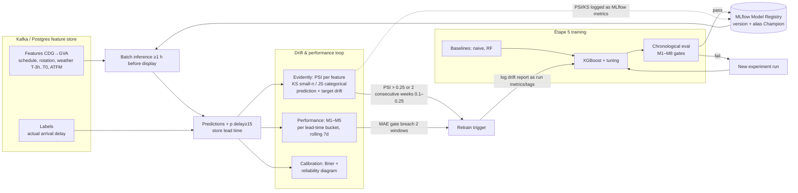

# ML Flight-Delay Prediction + Drift Measurement — Research Report (Étape 5)

Scope: XGBoost/MLflow model design, metric gates, data-drift measurement, retraining policy, CDG→GVA feature engineering. Non-goals (endpoints, architecture, RGPD) excluded.

---

## 1. State of the art 2024–2026

### 1.1 What the recent literature reports (sanity-check numbers)

| Study (year) | Task / granularity | Model | Reported metrics |
|---|---|---|---|
| AlBassam & AlShahrani, PLOS One 2025 ([link](https://journals.plos.org/plosone/article?id=10.1371/journal.pone.0335141)) | 3-class delay (<15 / 15–45 / ≥45 min), US 2018–22 Kaggle data | RF + random oversampling; DT + SMOTE | Acc 0.90, F1 0.90, MCC 0.73, ROC-AUC 0.87 |
| Same paper, related-work table | regression/classification, various | RF, GB, LSTM, CNN-LSTM hybrids | RF R²=0.94, **RMSE 12.5 min**; GB acc 84.5%; CNN-LSTM-RF acc 92.39%; LSTM recall 96.5% vs RF acc 82.21%; single-airport GRU MAE 0.3 min / RMSE 0.42 min; Beijing 3DF-DSCL MAE 0.26 min (single-airport, likely in-sample — treat with caution) |
| Liu et al., *Airport Delay Prediction with TFT*, 2024 ([arXiv:2405.08293](https://arxiv.org/abs/2405.08293), [HTML](https://arxiv.org/html/2405.08293v3)) | Airport-level mean arrival delay, 15-min bins, **4 h ahead** (2 h look-back), top-30 US airports | Temporal Fusion Transformer | **MAE 5–12 min** across airports (aggregate/smoothed target, not per-flight) |
| Lemay & Bastin, *Prediction of airport on-time performance*, 2025 ([arXiv:2601.00875](https://arxiv.org/html/2601.00875v1)) | Per-flight delay duration, **up to 36 h ahead**, one major international airport, 2019–2025, 652,781 flights, 29.91% delayed, mean delay 20.8 min (sd 67) | Gradient boosting vs RF vs linear | Prediction models (forecast weather): GB **MAE 20.11 min (dep) / 20.82 min (arr)**, RMSE ~53–56 min; classification weighted-F1 0.71, **recall on delayed class 0.64/0.62, precision 0.58/0.54** |
| FlightSense, 2026 ([arXiv:2605.07364](https://arxiv.org/html/2605.07364v1)) | Binary ArrDel15, 7.07 M BTS flights | XGBoost, progressive ablation | V1 schedule-only **AUC 0.732** → V2 + rotation-chain **0.875** → V3 + weather **0.879** (Acc 0.853, Recall 0.715, F1 0.650); baselines: LogReg 0.764, RF 0.811 |
| FlightSense cited baselines | binary delay | CatBoost→XGBoost two-stage (Zhou 2025) | AUC 0.865 → 0.898; Hari Chandana 2025: CatBoost R²=0.977 (dep), RF R²=0.950 (arr); Li & Jing 2022: error <30 min in 97% of cases |
| Sun et al., AI Review 2025 ([Springer](https://link.springer.com/article/10.1007/s10462-025-11400-w)) | Systematic review, 110 papers | — | Confirms EUROCONTROL **≥15 min arrival delay** as standard threshold; identifies delay propagation as dominant open challenge |

### 1.2 Which features matter (consistent across studies)

- **Delay propagation / aircraft rotation (dominant signal):** FlightSense shows propagation features are the **top-4 predictors** and deliver the largest gain (AUC 0.732→0.875) ([arXiv:2605.07364](https://arxiv.org/html/2605.07364v1)). Lemay & Bastin: "last flight to use the gate was delayed" is a top inference feature ([arXiv:2601.00875](https://arxiv.org/html/2601.00875v1)).
- **Schedule/historical punctuality:** Lemay & Bastin's top *prediction* features are **historical delay rate of the flight number and of the airline** — i.e., route+carrier persistence ([arXiv:2601.00875](https://arxiv.org/html/2601.00875v1)).
- **Congestion (origin/dest demand vs capacity):** TFT decoder importance: scheduled arrival demand, enroute traffic density, local hour ([arXiv:2405.08293v3](https://arxiv.org/html/2405.08293v3)); Lemay & Bastin: runway traffic, hour-of-day, overall airport congestion.
- **Weather:** TFT: enroute convective weather + visibility/ceiling are influential; FlightSense: snowfall is the top weather variable; Lemay & Bastin: precipitation/low visibility/temp extremes drop OTP measurably, and **forecast** (not observed) weather must be used at prediction time.
- **Day-of-week/season/holidays:** standard in all of the above (PLOS paper's engineered features; Lemay & Bastin season/weekend dials; TFT month/DOW static covariates).
- **Carrier & taxi time:** PLOS paper keeps TaxiOut/TaxiIn among top-25 selected features; taxi-out/in prediction itself is a mature ML subfield ([ACM XGBoost taxi-in 2024](https://dl.acm.org/doi/10.1145/3718751.3718900), [JSTAGE 2022](https://www.jstage.jst.go.jp/article/iwac/1/0/1_9/_article/-char/en), [NASA NTRS](https://ntrs.nasa.gov/api/citations/20190027063/downloads/20190027063.pdf)).

### 1.3 Which models win in practice

- **Tree ensembles (XGBoost/LightGBM/CatBoost/RF) are the pragmatic winner on tabular flight data** in 2024–2026: FlightSense's controlled ablation puts XGBoost (0.879) above RF (0.811) and LogReg (0.764); Lemay & Bastin consistently pick gradient boosting over linear models; PLOS picks RF/DT; the review literature calls ensembles the robust, interpretable baseline ([arXiv:2605.07364](https://arxiv.org/html/2605.07364v1), [arXiv:2601.00875](https://arxiv.org/html/2601.00875v1), [PLOS 2025](https://journals.plos.org/plosone/article?id=10.1371/journal.pone.0335141)).
- **Deep models (LSTM/Transformers)** win mainly on *aggregate, dense time-series targets* (TFT at airport-quarter-hour level, MAE 5–12 min) or single-hub settings, and require far more data/compute; deep hybrids rarely beat well-engineered GBDT on per-flight tabular features ([arXiv:2405.08293](https://arxiv.org/abs/2405.08293); PLOS related-work critique: "deep learning … require substantial computational resources and large labeled datasets" — [PLOS 2025](https://journals.plos.org/plosone/article?id=10.1371/journal.pone.0335141)).
- **Verdict for Étape 5:** XGBoost as primary, RF as cheap baseline, plus a naive baseline (predict-0 / seasonal-naive) — the ablation-style protocol of FlightSense is the right template.

### 1.4 Sanity-check of the project targets

- **"MAE < 15 min":** plausible but *not free*. Best-documented per-flight numbers at long horizon are 17–21 min MAE ([arXiv:2601.00875](https://arxiv.org/html/2601.00875v1)); 12.5 min RMSE in an older RF study (cited in [PLOS 2025](https://journals.plos.org/plosone/article?id=10.1371/journal.pone.0335141)); TFT reaches 5–12 min only on a smoothed *aggregate* target with 4 h look-ahead. For per-flight CDG→GVA at ≤6 h lead time with rotation + ATFM features, MAE <15 min is achievable `[INFERENCE]`; at 24–36 h it is aggressive `[INFERENCE]`.
- **"Predict ±10 min":** define as `within-10-min accuracy = mean(|ŷ−y| ≤ 10)`. Literature anchor: 97% of predictions within **30** min (Li & Jing 2022, cited in [arXiv:2605.07364](https://arxiv.org/html/2605.07364v1)). No published source guarantees ±10 min at ≥1 h lead — treat "±10 min" as a *reported metric with an honest baseline comparison*, not a guaranteed gate `[INFERENCE]`. A baseline of "predict the historical mean route delay" should be beaten by ≥20% relative MAE `[INFERENCE]`.
- **Class gate reality check:** recall on delayed (≥15 min) class of ~0.6 with precision ~0.55 at ~30% base rate is the published state for genuine out-of-sample prediction ([arXiv:2601.00875](https://arxiv.org/html/2601.00875v1)); AUC ~0.88 is SOTA-class for classification ([arXiv:2605.07364](https://arxiv.org/html/2605.07364v1)). Aim recall ≥0.70 at fixed threshold `[INFERENCE]`.

---

## 2. Formal metric definitions (gates for Étape 5)

All formulas are standard scikit-learn definitions ([sklearn model evaluation](https://scikit-learn.org/stable/modules/model_evaluation.html)); OTP/MAE/RMSE formalisms as used in a 2025 aviation paper ([arXiv:2601.00875](https://arxiv.org/html/2601.00875v1)).

| # | Metric | Formula / definition | Gate proposal (sprint acceptance) | Source |
|---|---|---|---|---|
| M1 | MAE | $\frac{1}{N}\sum|\hat y_i - y_i|$ (minutes) | **< 15 min** (project requirement); always report vs naive baseline | [sklearn](https://scikit-learn.org/stable/modules/model_evaluation.html), [arXiv:2601.00875](https://arxiv.org/html/2601.00875v1) |
| M2 | RMSE | $\sqrt{\frac{1}{N}\sum(\hat y_i-y_i)^2}$ | report only; RMSE/MAE ratio ≈ 1.5–2.5 observed in practice (53/20 in [arXiv:2601.00875](https://arxiv.org/html/2601.00875v1)) — ratio ≫ 3 ⇒ tail failures | same |
| M3 | Median AE | $\mathrm{median}|\hat y_i-y_i|$ (`median_absolute_error`) | report; robust to the heavy delay tail (delay sd = 67 min >> mean 21 min, [arXiv:2601.00875](https://arxiv.org/html/2601.00875v1)) | [sklearn](https://scikit-learn.org/stable/modules/model_evaluation.html) |
| M4 | Within-10-min accuracy | $\frac{1}{N}\sum \mathbf{1}\{|\hat y_i-y_i|\le 10\}$ | report at each lead time; no literature-justified universal threshold — set after first baseline run `[INFERENCE]` | definitional; ±30-min analogue in Li & Jing 2022 via [arXiv:2605.07364](https://arxiv.org/html/2605.07364v1) |
| M5 | Recall on delayed class | $TP/(TP+FN)$ for $y\ge 15$ min (EUROCONTROL/FAA 15-min convention) | ≥ 0.70 at chosen threshold; report precision + F1 too (class imbalance ~4:1 documented in [arXiv:2605.07364](https://arxiv.org/html/2605.07364v1)) | threshold: [Springer review](https://link.springer.com/article/10.1007/s10462-025-11400-w); recall ~0.62–0.64 published: [arXiv:2601.00875](https://arxiv.org/html/2601.00875v1) |
| M6 | Lead-time discipline | metric computed only on predictions issued ≥1 h before the official airport display update; **report M1/M4/M5 bucketed by lead time** (e.g., T-6h, T-3h, T-1h) | every gate evaluated per bucket; no pooled-only numbers | project requirement; horizon-conditioned evaluation mirrors TFT's multi-horizon setup ([arXiv:2405.08293](https://arxiv.org/abs/2405.08293)) and 36-h horizon protocol of [arXiv:2601.00875](https://arxiv.org/html/2601.00875v1) |
| M7 | Calibration (probability) | Brier score $\frac{1}{N}\sum(p_i-o_i)^2$; **reliability diagram**; ECE in 10 equal-frequency bins | Brier reported + ECE ≤ 0.05 `[INFERENCE]`; a claimed "85% chance of +20 min" must fall in its bin's observed frequency | [sklearn probability calibration](https://scikit-learn.org/stable/modules/calibration.html) (Brier/log-loss are "strictly proper scoring rules … assess calibration (reliability) and discrimination"); curves: [sklearn example](http://scikit-learn.org/stable/auto_examples/calibration/plot_calibration_curve.html) |
| M8 | Calibration (regression) | pinball/quantile loss or empirical coverage of prediction intervals (e.g., 80% interval contains y 75–85% of the time) | if XGBoost `reg:quantileerror`/multiple quantiles are used instead of a classifier | TFT uses quantile loss for exactly this "range estimate" purpose ([arXiv:2405.08293v3](https://arxiv.org/html/2405.08293v3)) |

Notes:
- Fix the split **chronologically** (train past → test future); random CV leaks seasonality. PLOS's stratified 10-fold is appropriate for their class-balance goal but not for time-ordered delay data `[INFERENCE]`; TFT and Lemay & Bastin both use temporal hold-outs ([arXiv:2405.08293](https://arxiv.org/abs/2405.08293), [arXiv:2601.00875](https://arxiv.org/html/2601.00875v1)).
- Leakage guard (from FlightSense): never feed post-flight columns (`ArrDelay`, `DepDelay`, `CarrierDelay`, `NASDelay`, `LateAircraftDelay`…) as features at pre-departure inference; compute rotation features from the *previous* leg only ([arXiv:2605.07364](https://arxiv.org/html/2605.07364v1)).

---

## 3. Data drift measurement

### 3.1 Metrics — what they measure

| Metric | Definition intuition | Best for | Reference |
|---|---|---|---|
| **PSI** | $\sum (c_i - e_i)\ln(c_i/e_i)$ over binned distributions (binned relative-frequency shift) | binned feature/prediction distribution shifts; industry-standard interpretability | [Minitab Model Ops](https://support.minitab.com/en-us/model-ops/monitor-deployed-models/details-about-the-population-stability-index-psi), [MathWorks](https://www.mathworks.com/help/risk/risk.validation.populationstabilityindex.html) |
| **KS test** | two-sample Kolmogorov–Smirnov statistic/p-value | small samples (≤1000 obs), numeric features | Evidently default for n≤1000: [docs](https://docs.evidentlyai.com/metrics/explainer_drift) |
| **Jensen–Shannon / KL** | divergence between distributions (JS symmetric, bounded) | categorical drift, large samples | Evidently defaults JS for categorical n>1000: [docs](https://docs.evidentlyai.com/metrics/explainer_drift) |
| **Wasserstein** | earth-mover distance on values (not just bins) | numeric drift on large data (Evidently default, threshold 0.1) | same as above |
| **Domain classifier AUC** | train a classifier to separate reference vs current; AUC>0.55 ⇒ drift | multivariate/text drift | Evidently [docs](https://docs.evidentlyai.com/metrics/explainer_drift); original method: [*Failing Loudly*, arXiv:1810.11953](https://arxiv.org/pdf/1810.11953.pdf) |

**Threshold conventions (PSI):** PSI < 0.1 = no significant shift; **0.1–0.25 = moderate shift** (investigate); **> 0.25 = major/critical shift** (retrain/act) — the industry-standard band, stated by [Minitab](https://support.minitab.com/en-us/model-ops/monitor-deployed-models/details-about-the-population-stability-index-psi) (large PSI ⇒ distributions differ), [MathWorks](https://www.mathworks.com/help/risk/risk.validation.populationstabilityindex.html) ("> 0.25 indicates a significant shift"), and [GeeksforGeeks](https://www.geeksforgeeks.org/data-science/population-stability-index-psi) (explicit 0.1/0.25 bands). Evidently's generic distance thresholds default to **0.1** with 0.95 confidence for tests ([docs](https://docs.evidentlyai.com/metrics/explainer_drift)).

### 3.2 Tooling at student-project scale

| Tool | What it gives you | Fit |
|---|---|---|
| **scikit-learn + scipy** | `ks_2samp`, `jensenshannon`, brier/calibration — zero extra deps | enough for gates if you want minimalism ([sklearn](https://scikit-learn.org/stable/modules/model_evaluation.html)) |
| **Evidently** | `DataDriftPreset`, PSI/KS/JS/Wasserstein/KL per column, HTML/snapshot reports, custom thresholds per column ([docs](https://docs.evidentlyai.com/metrics/preset_data_drift), [threshold customization](https://docs.evidentlyai.com/metrics/explainer_drift)) | **primary**: preset reports = fastest path to a graded drift demo; blog compares 5 drift methods on large data ([link](https://www.evidentlyai.com/blog/data-drift-detection-large-datasets)) |
| **alibi-detect** | statistical + learnable drift detectors (KSDrift, ChiSquareDrift, MMDDrift) ([PyPI](https://pypi.org/project/alibi-detect/), [docs](https://app.readthedocs.org/projects/alibi-detect/downloads/pdf/latest)) | backup / for "learned drift detector" bonus; heavier API |
| **whylogs** | streaming data profiles, drift + training-serving skew detection ([GitHub](https://github.com/whylabs/whylogs)) | optional if profiling inside the Kafka consumer |
| **MLflow** | log PSI values/metrics per run; registry versioning for retriggered retrains ([MLflow drift article](https://mlflow.org/articles/why-monitor-model-drift-production)) | **the glue**: monitoring results become metrics/tags on runs |

### 3.3 Wiring into the MLflow monitoring loop



Concrete wiring `[INFERENCE — implementation pattern built on the cited tools]`:
- Reference distributions = **training-set feature snapshot** (parquet) registered alongside the model version in MLflow.
- Per retraining window (e.g., weekly), compute PSI per feature + KS on small samples; write `psi/<feature>`, `drift/<feature>` (0/1) and dataset-drift count as MLflow metrics ([MLflow drift monitoring](https://mlflow.org/articles/why-monitor-model-drift-production)); keep Evidently HTML report as an MLflow artifact.
- Dataset-level rule: declare drift when **≥50% of columns drift** (Evidently configurable rule, [docs](https://docs.evidentlyai.com/metrics/explainer_drift)) or any *critical* feature (rotation delay, ATFM delay) exceeds PSI 0.25 `[INFERENCE]`.
- Monitor **target drift too** (delay distribution shifts with season/ATFM regulation load) — Evidently supports target/prediction drift alongside feature drift ([docs](https://docs.evidentlyai.com/metrics/preset_data_drift)).

---

## 4. MLOps 2026 — MLflow + retraining policy

- **Tracking:** runs grouped in an experiment; log params, metrics, artifacts (feature importance plot, confusion matrix, calibration curve) — standard MLflow Tracking model ([docs](https://mlflow.org/docs/latest/tracking/index.html)); official classical-ML tracking walkthrough: [mlflow.github.io](https://mlflow.github.io/mlflow-website/classical-ml/experiment-tracking).
- **Registry:** only runs that pass the quality gates move to the Registry; it holds lineage (experiment→run→model), versions, aliases (`champion`/`challenger`), and annotation ([registry docs](https://mlflow.org/docs/latest/ml/model-registry/), [registry checklist](https://mlflow.org/articles/ai-model-registry-management-checklist)). Gate pattern: Staging → Production only via gate metrics M1–M8.
- **Experiment-tracking best practice at this scale (3 students):** one experiment per model family; one run per configuration; log the *data snapshot hash* + split rule (chronological) as params so runs are reproducible; log baseline runs too (naive predictor) so every claim of "MAE<15" has a reference row `[INFERENCE — synthesis of MLflow best-practice docs]`.
- **Retraining policy for delay data:**
  - Delay data is seasonal (summer/winter OTP dips documented in [arXiv:2601.00875](https://arxiv.org/html/2601.00875v1)) and load-driven (ATFM minutes/flight vary weekly, EUROCONTROL [flash briefing](https://www.eurocontrol.int/sites/default/files/2026-07/eurocontrol-flash-briefing-2026-week27.pdf)) ⇒ **rolling-window retraining on recent seasons + scheduled periodic retrain** is the safe default.
  - Empirical evidence (2026, 3,933 runs): **simple periodic retraining significantly outperforms reactive (error-/drift-triggered) policies under abrupt and gradual drift**; reactive policies only win under recurring drift; deployment latency silently halves effective retraining budget ([arXiv:2608.19488](https://arxiv.org/abs/2608.19488)). ⇒ Recommendation: **periodic (e.g., monthly) retrain as the backbone, drift gates (PSI>0.25 / metric breach) as an *emergency* override**, not the primary cadence — grounded in that study, adapted to a student project `[INFERENCE for the cadence choice]`.
  - Always retrain against a chronological split and re-run all M-gates before registry promotion; keep the previous version as instant rollback (registry versioning, [docs](https://mlflow.org/docs/latest/ml/model-registry/)).

---

## 5. Feature engineering catalogue — CDG (LFPG) → GVA (LSGG)

| Group | Features | Evidence |
|---|---|---|
| **Schedule & calendar** | sched dep/arr time, hour-of-day bin, DOW, month/season, holiday/school-holiday flag, day-of-year, carrier, distance | all studies; PLOS engineered features ([PLOS](https://journals.plos.org/plosone/article?id=10.1371/journal.pone.0335141)); TFT static covariates ([arXiv:2405.08293v3](https://arxiv.org/html/2405.08293v3)) |
| **Route/carrier persistence** | historical delay rate of flight number, of carrier, of O/D pair (rolling 30/90 d) | top prediction features in [arXiv:2601.00875](https://arxiv.org/html/2601.00875v1) |
| **Upstream rotation (tail)** | `prev_arr_delay`, `prev_was_delayed`, turnaround time, tight-turnaround flag, cumulative daily delay of the tail, legs-flown-today | dominant gain AUC 0.732→0.875 ([arXiv:2605.07364](https://arxiv.org/html/2605.07364v1)); gate-turnaround effect in [arXiv:2601.00875](https://arxiv.org/html/2601.00875v1) |
| **Weather windows (T-3h…T0)** | latest METAR: wind speed/gust, crosswind component, visibility, ceiling/cloud, precip type/intensity; TAF trend categories at T-3h, T-1h, T0; encode as categorical trend (IMPROVING/NO CHANGE/WORSE) | weather importance: [arXiv:2405.08293v3](https://arxiv.org/html/2405.08293v3), [arXiv:2605.07364](https://arxiv.org/html/2605.07364v1), [arXiv:2601.00875](https://arxiv.org/html/2601.00875v1). T-3h…T0 window itself is a design choice: TFT uses a **2 h look-back** and Lemay & Bastin use forecast weather up to **36 h** ahead — a 3 h window sits between the two `[INFERENCE]` |
| **Forecast weather at lead time** | use the *forecast* valid at prediction issuance, never observed weather (leakage rule established in [arXiv:2601.00875](https://arxiv.org/html/2601.00875v1)) | mandatory for ≥1 h lead-time honesty |
| **Airport congestion** | sched demand vs capacity per 15 min at CDG & GVA, hour-of-day queueing delay proxy, on-time % of airport last 24 h | TFT inputs/queuing model ([arXiv:2405.08293v3](https://arxiv.org/html/2405.08293v3)) |
| **ATFM (Eurocontrol)** | en-route/arrival ATFM delay minutes per flight (regulation minutes, CTOT shift), weekly ATFM min/flight context; pre-tactical regulation predictions are feasible with supervised models | ATFM/CTOT mechanics: [Eurocontrol think paper](https://www.eurocontrol.int/sites/default/files/2020-01/eurocontrol-think-paper-2-atfm-regulation.pdf); pre-tactical per-flight ATFM prediction: [Mas Pujol 2022, UPC](https://upcommons.upc.edu/bitstreams/0e4fa8e2-467d-4220-9df9-b248b5d0dd9f/download); current ATFM levels: [flash briefing](https://www.eurocontrol.int/sites/default/files/2026-07/eurocontrol-flash-briefing-2026-week27.pdf) |
| **Taxi time** | expected taxi-out at CDG, taxi-in at GVA (route/aircraft-type historical means; ML-predicted taxi if data allows) | taxi-time ML literature: [ACM 2024](https://dl.acm.org/doi/10.1145/3718751.3718900), [NASA](https://ntrs.nasa.gov/api/citations/20190027063/downloads/20190027063.pdf); TaxiOut among PLOS top-25 ([PLOS](https://journals.plos.org/plosone/article?id=10.1371/journal.pone.0335141)) |
| **Drift-monitor groups** | monitor drift per *group* (schedule / rotation / weather / ATFM / congestion) so a retrain trigger names the culprit `[INFERENCE]` | — |

```mermaid
gantt:title CDG→GVA feature timeline (lead-time ≥ 1 h before official display)
dateFormat HH:mm
axisFormat %H:%M
section Rotation
Upstream legs of tail (delay so far today)   :done, 00:00, 6h
section Weather window
METAR/TAF snapshots T-3h→T0                 :active, 13:00, 3h
section Congestion/ATFM
Demand-capacity + ATFM delay (rolling)      :13:00, 4h
section Prediction
Model issues prediction (gate M6)           :milestone, 16:00, 0min
section Truth
Official display update / actual arrival    :milestone, 17:00, 0min
```

---

## Recommended source stack

| Data category | Primary | Backup | Rationale | Risk |
|---|---|---|---|---|
| Historical flight schedule + realized delays (labels) | Eurocontrol flights/ATFM history for Europe ops context (scope of DataSource agent) | Kaggle/BTS-style on-time datasets for offline prototyping ([PLOS uses Kaggle 2018–22](https://journals.plos.org/plosone/article?id=10.1371/journal.pone.0335141)) | European route needs European labels; BTS-style data fine for method dev only | Coverage of small carriers; delayed label availability → label lag corrupts rolling eval |
| Live flight status (prediction input + eventual ground truth) | DataSource agent's primary feed | Airport-operator feeds for CDG/GVA | Must align with ≥1 h lead-time measurement | Feed outage ⇒ missing features; mitigate by caching last-known values `[INFERENCE]` |
| Weather obs (METAR) | NOAA/ICAO METAR archive | Open-Meteo/Meteo-France history | METAR is the operational standard used implicitly by airport studies ([TFT uses ISD surface obs](https://arxiv.org/html/2405.08293v3)) | Station gaps; gust vs sustained wind coding |
| Weather forecast (must be used at T-3h…T0) | Open-Meteo / national forecast API | ECMWF open data | Forecast-not-observed rule is mandatory for honest lead time ([arXiv:2601.00875](https://arxiv.org/html/2601.00875v1)) | Forecast vintage mismatch → re-forecast snapshots per issuance `[INFERENCE]` |
| ATFM / network regulation | Eurocontrol network data ([think paper](https://www.eurocontrol.int/sites/default/files/2020-01/eurocontrol-think-paper-2-atfm-regulation.pdf), weekly stats) | flight-status ATFM delay fields | ATFM is the European delay driver absent in US datasets | Access/licensing per DataSource agent; sparse at flight level pre-regulation |
| Aircraft rotation (tail chain) | primary flight feed with registration/tail | reconstruct from flight-number adjacency + schedule ([FlightSense reconstructs from tail numbers](https://arxiv.org/html/2605.07364v1)) | top predictive signal — worth the extra effort | Tail unknown on some legs → fallback: scheduled equipment/rotation by flight number `[INFERENCE]` |
| Drift measurement | **Evidently** ([docs](https://docs.evidentlyai.com/metrics/preset_data_drift)) | **alibi-detect** ([PyPI](https://pypi.org/project/alibi-detect/)) / raw **scipy KS + PSI code** | Preset reports + per-column method choice; PSI thresholds convention ([Minitab](https://support.minitab.com/en-us/model-ops/monitor-deployed-models/details-about-the-population-stability-index-psi)) | Evidently API churn between major versions — pin version `[INFERENCE]` |
| Experiment tracking / registry | **MLflow** (tracking + registry, local/SQLite/Postgres) ([docs](https://mlflow.org/docs/latest/tracking/index.html)) | notebook-level CSV logs (only as throwaway fallback) | Registry gates + lineage are exactly Étape 5's story ([checklist](https://mlflow.org/articles/ai-model-registry-management-checklist)) | Single local server bottleneck → fine at this scale; back up the MLflow DB `[INFERENCE]` |
| Model library | **XGBoost** (+ scikit-learn RF/logreg baselines) | LightGBM (drop-in equivalent) | Ablation-verified winner vs RF/LR ([arXiv:2605.07364](https://arxiv.org/html/2605.07364v1)); GB best in [arXiv:2601.00875](https://arxiv.org/html/2601.00875v1) | Class imbalance → set `scale_pos_weight` ~ ratio (4.23 documented in FlightSense) |
| Calibration | scikit-learn `CalibratedClassifierCV` (isotonic) + reliability diagram + Brier ([docs](https://scikit-learn.org/stable/modules/calibration.html)) | quantile XGBoost + interval coverage (TFT-style, [arXiv:2405.08293v3](https://arxiv.org/html/2405.08293v3)) | Makes "85% chance of +20 min" honest | Isotonic overfits small validation sets → use sigmoid for n<~1000 `[INFERENCE]` |
