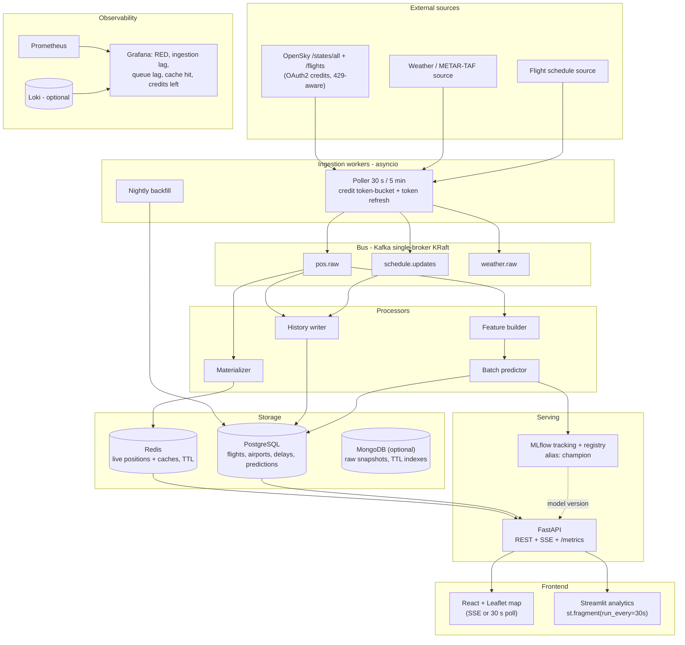
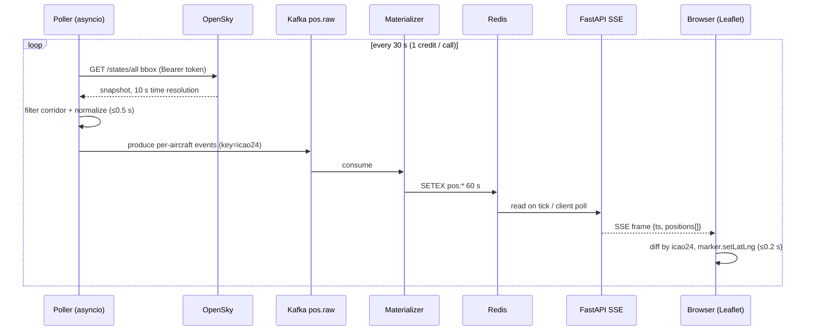

# Real-Time Data Platform Architecture — Research Report
**Scope:** feeds Étape 4 (relational + NoSQL organization & ingestion), Étape 6 (API + Docker), Étape 7 (deployment + Prometheus/Grafana). Excludes ML model choice, data-source endpoint selection (peer agent), RGPD/legal (peer agent).

---

## 1. Ingestion / streaming at student scale

### 1.1 Bus options: when Kafka is overkill

| Option | Infra cost | Durability / replay | Ops burden | Verdict for this project |
|---|---|---|---|---|
| **Kafka, 1-broker KRaft** | Official image runs standalone: `docker run -d --name broker apache/kafka:latest` ([Docker Hub](https://hub.docker.com/r/apache/kafka)); upstream ships a ready single-node plaintext compose file ([apache/kafka repo](https://github.com/apache/kafka/blob/trunk/docker/examples/docker-compose-files/single-node/plaintext/docker-compose.yml)). ZooKeeper is gone: "Kafka 4.0 only supports KRaft mode — ZooKeeper mode has been removed" ([Kafka 4.0 upgrade docs](http://kafka.apache.org/40/getting-started/upgrade), [4.0 release announcement](https://kafka.apache.org/blog/2025/03/18/apache-kafka-4.0.0-release-announcement/)) → 1 container, not 2. RAM ≈ 1–2 GB heap **[INFERENCE]** | Full log retention, replay, consumer groups | Low-medium (single broker, no cluster) | **Recommended**: stack mandates Kafka; cost is now one container |
| **Redpanda** | Kafka-API-compatible, "No Zookeeper, no JVM, no code changes" ([Docker Hub](https://hub.docker.com/r/redpandadata/redpanda)); production sizing = ≥2 cores, ≥2 GB RAM/core ([Redpanda requirements](https://docs.redpanda.com/streaming/current/deploy/redpanda/manual/production/requirements.md)) | Same semantics as Kafka | Lower tuning, but source-available license with enterprise flags ([cluster properties note](https://docs.redpanda.com/streaming/current/reference/properties/cluster-properties)) | **Backup** if Kafka JVM/RAM tuning hurts on a small laptop |
| **Redis Streams** | Zero extra containers (Redis already in stack); `XADD … MAXLEN ~10000` ([XADD](https://redis.io/docs/latest/commands/xadd/)), consumer groups via `XREADGROUP` ([XREADGROUP](https://redis.io/docs/latest/commands/xreadgroup/)) | Bounded replay (trimmed log), survives restarts | Minimal | **CI/local-dev fallback** behind a thin producer/consumer interface; fine as the *only* bus if Kafka were optional |
| **Plain asyncio (no bus)** | Nothing | None (in-process queue lost on crash) | None | Enough for 1 producer + 1 consumer, but couples ingestion to serving and kills replay — avoid as primary |

**When Kafka is genuinely overkill:** single producer, ≤~10 msg/s, 1–2 consumers, no replay/audit need, team of 3 **[INFERENCE]** — that describes the *corridor* workload exactly. We keep Kafka anyway because (a) the mandated stack lists it, (b) it decouples 3 consumers (live-cache materializer, history writer, feature builder), (c) it gives you consumer-lag metrics for Étape 7 "for free", (d) cost is one container. Design rule: produce/consume through a tiny `Bus` interface so tests and CI can swap in Redis Streams **[INFERENCE — design choice]**.

**Scale check:** even the *whole-Europe* fan-out (~83 msg/s at 2-min polling, ~330 msg/s at 30 s — math below) is orders of magnitude below one broker's capacity **[INFERENCE]**. Throughput will never be the constraint; **API credits and browser marker count will be**.

### 1.2 Throughput & quota math (drives everything)

All quota facts from the official OpenSky REST docs ([source](https://openskynetwork.github.io/opensky-api/rest.html)): `/states/all` costs credits by bounding-box area (≤25 sq° or serial-only = **1**, 25–100 = 2, 100–400 = 3, >400/global = **4**); daily quotas per endpoint bucket: **anonymous 400, standard 4 000**, active-feeder 8 000; on exhaustion → `429` + `X-Rate-Limit-Retry-After-Seconds`; `X-Rate-Limit-Remaining` exposes balance; anonymous time resolution 10 s (time param ignored), authenticated 5 s, history ≤1 h; OAuth2 client-credentials tokens expire after 30 min. `/flights/*` lives in a **separate** bucket, 4 credits per live call.

| Scenario | Bbox | Area → cost | Calls/day @30 s | Credits/day | Fits quota? |
|---|---|---|---|---|---|
| **Corridor LFPG→LSGG** (lat 45.8–49.5, lon 1.5–7.5, approximate **[INFERENCE]**) | 3.7°×6° | 22 sq° → **1 credit** | 2,880 | 2,880 | Standard 4,000 ✅ (28 % margin); **Anonymous 400 ❌** → max 1 call/3.6 min |
| **Whole-Europe view** (35–72 N, −10–40 E **[INFERENCE]**) | 37°×50° | 1,850 sq° → **4 credits** | 2,880 | **11,520** | ❌ even Standard — max sustainable = 1,000 calls/day ≈ **1 call/86 s**; @120 s cadence: 720×4 = 2,880 ✅ |
| Schedule polling (`/flights/*`, separate bucket) | — | 4 credits/live | @1 min: 1,440×4 = 5,760 ❌ | — | @5 min: 288×4 = **1,152** ✅ |

**Payload sizes (positional 18-field rows per official schema; counts are [INFERENCE]):**

| View | Aircraft in view [INFERENCE] | Snapshot JSON [INFERENCE] | Downstream msg rate [INFERENCE] |
|---|---|---|---|
| Corridor @30 s | ~100–300 | **15–75 KB** | 300 ÷ 30 s ≈ **10 msg/s** |
| Whole-Europe @120 s | ~10,000–13,000 | **1.5–3 MB** | 10,000 ÷ 120 s ≈ **83 msg/s** |
| Whole-Europe @30 s (hypothetical) | same | 1.5–3 MB | ≈ **330 msg/s** (and unaffordable in credits, see above) |

Corridor history volume if persisted: 300 × 2,880 × ~200 B ≈ **170 MB/day** raw ≈ 15 GB/90 days **[INFERENCE arithmetic]** → keep hot 7–30 days in PG, aggregate older.

### 1.3 Recommended minimal ingestion pattern

- **One asyncio poller service** (separate container, `asyncio` + `httpx.AsyncClient`): fetch every 30 s → honor `429`/Retry-After with backoff → **credit-aware token bucket** (capacity = daily quota × 0.9, e.g., 3,600 for corridor standard **[INFERENCE design]**) → refresh OAuth2 token with 30 s margin (official example pattern, [docs](https://openskynetwork.github.io/opensky-api/rest.html)) → normalize → produce to Kafka.
- **Cadence plan:** positions **30 s** (corridor bbox, 1 credit/call), flight schedule **5 min** (4 credits/call), weather **5–15 min** (cache TTL, not upstream hammering), nightly historical backfill job (replayable to PG).
- **Topics:** `pos.raw` (key=`icao24`, retention 24–48 h), `schedule.updates`, `weather.raw`, `predictions.out`, `deadletter` **[INFERENCE — proposed design]**. log compaction only for keyed snapshot topics like `schedule.current` **[INFERENCE]**.
- **Consumers:** ① materializer → Redis (`SETEX`, TTL 60 s), ② history writer → PostgreSQL batch insert (one COPY per 30-s tick **[INFERENCE]**), ③ feature builder → triggers/feeds predictions.

---

## 2. Storage split (Étape 4)

**Decision rule:** relational = anything with joins, constraints, SQL analytics, long retention; document = evolving/raw payloads with TTL; cache = sub-second reads, never the only durable copy.

### 2.1 PostgreSQL (source of truth)

| Table (sketch) | Key columns | Notes / index |
|---|---|---|
| `airports` | `icao` PK, `iata`, name, city, `lat`, `lon`, tz, country | dimension |
| `routes` | `id`, `origin_icao`, `dest_icao`, distance_km, typical_duration_min | corridor row LFPG→LSGG |
| `flights` | `id`, `flight_date`, `flight_number`, `origin_icao`, `dest_icao`, `sched_dep_tz`, `sched_arr_tz`, `aircraft_reg`, `status` | unique `(flight_date, flight_number)`; partial index on `flight_date` |
| `flight_observations` | `flight_id` FK, `ts`, `lat`, `lon`, `alt_m`, `gs_mps`, `track_deg`, `vrate_mps` | partition/retention 7–30 d; only corridor subset |
| `delays_history` | `flight_id` FK, `dep_delay_min`, `arr_delay_min`, `delay_class`, computed weather join keys | window functions for per-route/per-hour stats |
| `weather_observations` | `station`, `ts`, wind_kt, temp_c, precip, vis_m, raw_jsonb | for correlation analysis |
| `ml_predictions` | `id`, `flight_id`, `model_name`, `model_version`, `predicted_delay_min`, `proba`, `feature_snapshot jsonb`, `created_at` | audit trail joining to MLflow version |
| `ingestion_runs` | `job`, `started_at`, `last_success_ts`, `records`, `credits_remaining`, `status` | drives the ingestion-lag metric |

Why PG: delay analytics are JOIN-heavy (flight × airport × route × weather × prediction) and that's the graded "relationnel" story **[INFERENCE]**.

### 2.2 MongoDB (optional document layer) — TTL-based ephemerality

- `live_positions`: `{_id: icao24, callsign, lat, lon, alt, ts}` + TTL index `expireAfterSeconds: 60` on `ts` — MongoDB TTL indexes "automatically remove documents … after a certain amount of time" ([MongoDB TTL docs](https://www.mongodb.com/docs/manual/core/index-ttl/)).
- `raw_snapshots`: `{source, fetched_at, http_status, payload}` TTL 48 h — replay/debug when ML or demo data looks wrong.
- `flights_by_day`: `{flight_date, flight_number, schedule_doc, sources[], updated_at}` — schema drifts per source without ALTER TABLE.
- `weather_cache`: `{station, kind, fetched_at, expires_at}` TTL on `expires_at`.
- Honest take: with Redis + PG this layer is *convenience, not necessity*; include it if Étape 4 grading expects a document DB, otherwise defer **[INFERENCE]**.

### 2.3 Redis (hot path + rate-limit protection)

| Key pattern | Type | TTL | Purpose |
|---|---|---|---|
| `pos:{icao24}` / `pos:snapshot:{bbox_hash}` | hash / string (JSON) | **60 s** (must exceed 30-s poll cadence) | live map feed, read on every API hit |
| `wx:{station}:{kind}` | string | 300–900 s + ±10 % jitter | weather cache; jitter prevents synchronized expiry stampede **[INFERENCE]** |
| `cache:v1:{resource}:{params}` | string | per-endpoint (15–300 s), `SETEX` | API cache-aside; serve-stale-then-refresh **[INFERENCE]** |
| `lock:fill:{resource}:{params}` | `SET NX PX 3000` | 3 s | single-flight, cache-stampede guard **[INFERENCE]** |
| `rl:opensky:states:{YYYYMMDD}` | string counter + `EXPIRE` at midnight | 24 h | mirrors official daily credit bucket; soft-stop at 90 % of quota **[INFERENCE design]** |
| `rl:api:{ip}:{endpoint}:{minute}` | counter | 60 s | fixed-window limiter on *our* public API |
| `bus:…` (if Redis Streams mode) | stream, `XADD ~MAXLEN` | trimmed | CI/dev bus fallback ([XADD](https://redis.io/docs/latest/commands/xadd/)) |

`SETEX` semantics: [redis.io/setex](https://redis.io/docs/latest/commands/setex/).

---

## 3. Serving: FastAPI endpoint design (Étape 6)

### 3.1 Endpoints & caching headers

| Endpoint | Backing store | `Cache-Control` | Notes |
|---|---|---|---|
| `GET /api/v1/flights?number=AF118&date=…` | PG (+ Redis) | `public, max-age=300` | ETag → 304 revalidation ([MDN HTTP caching](https://developer.mozilla.org/en-US/docs/Web/HTTP/Caching)) |
| `GET /api/v1/airports/{code}/schedule?role=dep\|arr&date=` | PG (refreshed ≥5 min) | `public, max-age=60, s-maxage=60` | align cache TTL with upstream cadence |
| `GET /api/v1/flights/{id}` | PG | `public, max-age=60` | detail + delay stats |
| `GET /api/v1/positions?bbox=…` | Redis | `public, max-age=15, s-maxage=15, stale-while-revalidate=30` | payload carries `as_of` + `stale` flag |
| `GET /api/v1/predictions/{flight_id}` | PG | `public, max-age=60` | include `model_name:version` from MLflow |
| `GET /api/v1/stream/positions` | Redis → SSE | `no-store`, `text/event-stream`, `X-Accel-Buffering: no` **[INFERENCE]** | heartbeat every 15 s **[INFERENCE]** |
| `GET /healthz`, `GET /metrics` | — | `no-store` | `/metrics` bound internal-only **[INFERENCE]** |

Implementation notes: Pydantic v2 response models; `redis.asyncio`; CORS restricted to the frontend origin ([FastAPI CORS](https://fastapi.tiangolo.com/tutorial/cors/)); one `prometheus-fastapi-instrumentator` line wires histograms ([repo](https://github.com/trallnag/prometheus-fastapi-instrumentator)). The poller is a separate container from the API (independent restart/scale) **[INFERENCE — design]**.

### 3.2 Transport: 30-s polling vs SSE vs WebSocket

| | 30-s polling | SSE (`EventSource`) | WebSocket |
|---|---|---|---|
| Mechanism | client GETs `/positions` every 30 s | server pushes frames over one HTTP connection ([MDN: using SSE](https://developer.mozilla.org/en-US/docs/Web/API/Server-sent_events/Using_server-sent_events)) | full-duplex |
| Built-in reconnect / Last-Event-ID | n/a (trivial retry) | yes ([MDN EventSource](https://developer.mozilla.org/en-US/docs/Web/API/EventSource)) | you write it **[INFERENCE]** |
| Load at demo scale (50 viewers) | 1.7 req/s — trivial | 1 long-lived connection each | heaviest proxy/TLS/config cost |
| Verdict | **v1 default & fallback** | **recommended upgrade** for the live map (server→client only fits our flow) | not needed: viewport changes fit in query params |

### 3.3 Latency budget for "refresh every 30 s" (targets, all [INFERENCE])

| Stage | Budget | Cumulative |
|---|---|---|
| Poll tick → OpenSky response received | ≤ 2.0 s | 2.0 s |
| Parse + corridor filter + normalize | ≤ 0.5 s | 2.5 s |
| Kafka produce → materializer consume | ≤ 0.2 s | 2.7 s |
| Redis `SETEX` | ≤ 0.05 s | 2.75 s |
| SSE push (or next client poll) | ≤ 0.5 s | 3.25 s |
| Browser diff-render ≤300 markers | ≤ 0.2 s | **≈ 3.45 s** |

So end-to-end freshness ≤ 30 s (cadence) + ~4 s (processing) — well inside the requirement. Proposed SLOs: API p95 ≤ 300 ms; ingestion lag ≤ 60 s (alert at 90 s = 3 missed cycles).

---

## 4. Frontend: real-time aircraft map

| | **Streamlit** | **Plotly Dash** | **React + Leaflet** |
|---|---|---|---|
| Live refresh | native: `st.fragment(run_every="30s")` ([docs](https://docs.streamlit.io/develop/api-reference/execution-flow/st.fragment)); cache with `st.cache_data(ttl=…)` ([caching docs](https://docs.streamlit.io/develop/concepts/architecture/caching)) | `dcc.Interval` fires callbacks ([dash.plotly.com](https://dash.plotly.com/)) | SSE `EventSource` or 30-s fetch loop |
| Map quality | `st.map` / Plotly `scattermapbox` ([plotly](https://plotly.com/python/scattermapbox/)); full-page reruns, no smooth marker motion | mapbox token needed for scattermapbox **[INFERENCE]**; medium polish | Leaflet 1.9.4 ([unpkg](https://app.unpkg.com/leaflet@1.9.4), [leafletjs.com](https://leafletjs.com/)): marker diffing, rotation by `true_track`, clustering, canvas renderer |
| Effort (3 students) | **1–3 days** | ~1 week | **1–2 sprints** (Vite/TS toolchain; [react-leaflet releases](https://github.com/PaulLeCam/react-leaflet/releases)) |
| Verdict | analytics/EDA companion UI ✅ | only if team is Python-only end-to-end | **hero real-time map ✅** |

**Smooth 30-s updates (React+Leaflet) [INFERENCE]:** keep the map instance mounted (never re-create on data); key markers by `icao24`; update via `setLatLng` + rotate icon by `true_track`; optional linear interpolation between ticks; `preferCanvas: true` or a marker-cluster for wide views; throttle tile loads by viewport.

**Tile providers:**

| Provider | Terms | Use |
|---|---|---|
| `tile.openstreetmap.org` | OSMF Tile Usage Policy: servers are donation-funded, capacity-limited; heavy/production use needs permission or another host ([policy](https://operations.osmfoundation.org/policies/tiles)) | dev only, low volume |
| **CARTO Positron/Dark matter** | free tier, free API key without account ([FAQ](https://docs.carto.com/faqs/carto-basemaps)); non-commercial fair use = **5,000,000 tiles/month** ([terms](https://carto.com/legal/basemap-terms)); key via [API-key page](https://carto.com/basemaps/apikey/index.html) | **recommended default** (clean traffic-map look) |
| Self-hosted vector tiles (OpenFreeMap/Protomaps) | no-key freedom, but extra infra **[INFERENCE]** | out of scope |

(Leaflet's provider registry lists these swaps: [leafletjs.com/examples/providers](https://leafletjs.com/examples/providers/).)

---

## 5. MLflow + model serving

- **Tracking server in compose:** `mlflow server` with SQLite backend + `./mlruns` (or MinIO) artifact root; one experiment per student, run = params/metrics/artifacts ([MLflow Model Registry](https://mlflow.org/docs/latest/ml/model-registry/)).
- **Registry flow:** `mlflow.register_model` → version N → **alias `champion`** (production) / `candidate` (staging). Stages are deprecated: "mark model registry stages as deprecated starting in MLflow 2.9" ([RFC #10336](https://github.com/mlflow/mlflow/issues/10336)); aliases documented in [Registry Workflows](https://mlflow.org/docs/latest/ml/model-registry/workflow/).
- **Batch vs online inference:**

| | Batch predictions (recommended core) | Online inference (FastAPI) |
|---|---|---|
| Trigger | nightly + every-15-min micro-batch cron container reading PG features **[INFERENCE]** | on-demand `GET /predictions/{flight_id}` |
| Freshness | ≤ batch interval (fine for schedule-level delay risk) | seconds |
| Ops | writes `ml_predictions` rows → full audit/replay; failures = retry next tick | model loaded at startup, refresh when `champion` alias moves (poll every N min **[INFERENCE]**); keeps previous model in memory as fallback |
| Cost/risk | none new | cold-start load seconds; memory for 1–2 models **[INFERENCE]** |

- Recommended hybrid: **batch writes the daily score table** (map + dashboard read it), **online endpoint recomputes on demand** from the same features; both stamp `model_version` so Grafana/Grafana-side comparisons and grading demos are traceable **[INFERENCE — design]**.

---

## 6. Deployment & observability (Étape 6 + 7)

### 6.1 docker-compose full stack

| Service | Image / role | Profile | RAM est. [INFERENCE] |
|---|---|---|---|
| `kafka` | `apache/kafka` KRaft single node ([compose example](https://github.com/apache/kafka/blob/trunk/docker/examples/docker-compose-files/single-node/plaintext/docker-compose.yml)) | `full` | 1–2 GB |
| `postgres` | persistent volume, init SQL migrations | always | 300 MB |
| `mongo` | TTL indexes via init script | `full` (optional) | 300 MB |
| `redis` | `--appendonly yes` | always | 100 MB |
| `ingest` | asyncio poller (positions/schedule/weather) | always | 200 MB |
| `consumer` | Kafka → Redis materializer + history writer | `full` | 200 MB |
| `api` | uvicorn + FastAPI + instrumentator | always | 200 MB |
| `predict` | nightly/micro-batch batch predictor | `full` | burst 1 GB |
| `mlflow` | tracking UI/server | `full` | 300 MB |
| `frontend` | nginx static build (React) or streamlit | always | 150 MB |
| `prometheus`, `grafana` | scrape configs + provisioned dashboards | `always` (demo profile) | 500 MB |
| `kafka-exporter`, `redis_exporter`, `node-exporter`, `cadvisor` | lag/cache/host/container metrics | `obs` | ~200 MB |
| `loki` + `promtail` (optional) | log aggregation | `obs` | 300 MB |
| `caddy`/`traefik` | TLS on the VM | `prod` | 50 MB |

Docker profiles keep `docker compose up` light for daily dev (no Kafka/MLflow) while the demo profile starts everything **[INFERENCE — design]**. Total full stack ≈ **6–10 GB RAM / 20–40 GB disk over a semester [INFERENCE]** → any 16 GB laptop, and the Oracle free ARM shape below.

### 6.2 CI (GitHub Actions)

- Free tier: "usage is free … for public repositories"; Free plan private repos get **2,000 minutes/month** ([Actions billing docs](https://docs.github.com/en/billing/concepts/product-billing/github-actions), [pricing](https://github.com/pricing)).
- Pipeline (<10 min **[INFERENCE]**): ① ruff + mypy; ② pytest with `services:` containers (postgres/redis/mongo/kafka) **[INFERENCE]**; ③ frontend lint + `vite build`; ④ `docker build` → push GHCR; ⑤ `docker compose config` validation; ⑥ on `main`: SSH deploy job (pull + `compose up -d --remove-orphans`) **[INFERENCE]**.

### 6.3 Metrics & dashboards (Prometheus + Grafana)

Naming/histogram conventions per [Prometheus naming](https://prometheus.io/docs/practices/naming/) and [histograms](https://prometheus.io/docs/practices/histograms/).

| Metric (proposed) | Type | Source | Panel / alert |
|---|---|---|---|
| `api_request_duration_seconds{handler,method,status}` | histogram | [fastapi-instrumentator](https://github.com/trallnag/prometheus-fastapi-instrumentator) | RED latency p95; alert p95 > 300 ms **[INFERENCE]** |
| `api_requests_total` | counter | same | RPS + error rate by status |
| `ingest_last_success_timestamp_seconds` | gauge | ingest worker | **ingestion lag** = `time() - value`; alert > 90 s |
| `ingest_credits_remaining` | gauge | parsed from `X-Rate-Limit-Remaining` ([official header](https://openskynetwork.github.io/opensky-api/rest.html)) | quota runway; alert < 10 % |
| `ingest_api_requests_total{status}` | counter | poller | 429 spikes = quota breach |
| `kafka_consumergroup_lag` / topic offsets | gauge | kafka-exporter; ready-made dashboards [24565](https://grafana.com/grafana/dashboards/24565-kafka-metrics-dashboard), [11963](https://grafana.com/grafana/dashboards/11963-kafka-lag); or [kafka-lag-exporter](https://github.com/seglo/kafka-lag-exporter) | **queue depth / consumer lag** |
| `redis_connected_commands_total`, app `cache_hits_total`/`cache_misses_total` | counter | [redis_exporter](https://github.com/oliver006/redis_exporter) + app counters | **cache hit rate** panel; alert < 80 % **[INFERENCE]** |
| `positions_tracked`, `predictions_total` | gauge/counter | API/consumer | business health |
| Host/container CPU-mem | gauge | node-exporter, cAdvisor | capacity for the VM |

Grafana alerting → email/Slack webhook on ingestion lag, 429 rate, cache-hit drop ([Grafana docs](https://grafana.com/docs/grafana/latest/)).

**Logs:** structured JSON to stdout only; Docker `json-file` driver with `max-size`/`max-file` rotation ([Docker logging config](https://docs.docker.com/engine/logging/configure/)); optional Loki+promtail for search UI ([Loki docs](https://grafana.com/docs/loki/latest/)). Avoid ELK at this scale **[INFERENCE]**.

### 6.4 What "production" realistically means for students

| Tier | Setup | Cost | Notes |
|---|---|---|---|
| 0 — daily dev | local `docker compose` | €0 | default |
| 1 — demo/graded (**recommended**) | one VM: Oracle Always Free Arm ("1,500 OCPU-hours and 9,000 GB-hours per month" free forever — ≈12 GB running 24/7 **[INFERENCE arithmetic]**; [Always Free resources](https://docs.oracle.com/en-us/iaas/Content/FreeTier/freetier_topic-Always_Free_Resources.htm), [cloud/free](https://www.oracle.com/cloud/free)) or any ~€4–7/mo VPS **[INFERENCE]**; Caddy TLS; GH Actions SSH deploy; `restart: unless-stopped`; daily `pg_dump` to object storage | €0–7/mo | full stack fits if RAM ≥ 8 GB |
| 2 — PaaS (partial) | Render free web services (reportedly sleep after 15 min idle — [reported](https://temps.sh/compare/vs-render), pricing: [render.com/pricing](https://render.com/pricing)); Streamlit Community Cloud for the analytics app only (free public apps; 1 GB / sleep limits [reported](https://livemy.app/blog/deploy-streamlit-app), official docs: [Streamlit Cloud](https://docs.streamlit.io/deploy/streamlit-community-cloud)); Hugging Face Docker Spaces for the API demo ([spaces overview](https://github.com/huggingface/hub-docs/blob/main/docs/hub/spaces-overview.md)) | €0 | **no free tier for the full compose stack**: Fly.io discontinued its plans for new customers ([official](https://fly.io/docs/about/discontinued-plans)); Railway has no free tier [reported](https://dev.to/pavel-hostim/render-vs-railway-vs-flyio-pricing-compared-2026-2e5p) |

Realistic definition of "production" here: *demo-day reliable*, not 24/7 SLA — single VM, TLS, healthchecks + auto-restart, backups, dashboards, graceful degradation (OpenSky down → API serves last snapshot with `stale: true`) **[INFERENCE]**.

---

## 7. Étape mapping (deliverable checklist)

- **Étape 4:** §1.3 ingestion pattern + cadence/quota tables; §2 schemas (PG + Mongo + Redis key patterns); Kafka topics & retention.
- **Étape 6:** §3 endpoint table + caching headers; §6.1 compose file with profiles; §4 frontend choice.
- **Étape 7:** VM deploy + GH Actions; §6.3 metrics table → Grafana provisioning; alert rules (ingestion lag, 429s, cache hit, consumer lag); log rotation/Loki.

---

## Recommended source stack (primary / backup per category)

| Category | Primary | Backup | Rationale | Risk |
|---|---|---|---|---|
| Live positions | OpenSky `/states/all` bbox=corridor, 30 s, authenticated ([docs](https://openskynetwork.github.io/opensky-api/rest.html)) | Cached last snapshot (serve `stale:true`); widened-key `icao24` queries | 1 credit/call → affordable at 30 s; official quota headers drive the scheduler | Anonymous 400 credits/day kills 30-s cadence; 429 bursts → need token bucket + backoff **[INFERENCE]** |
| Schedule updates | OpenSky `/flights/*` bucket @5 min (separate 4,000/day bucket, 4 credits/live) ([docs](https://openskynetwork.github.io/opensky-api/rest.html)) | Nightly static timetable CSV → PG | cheap, replayable | endpoint choice deferred to DataSourceResearch; schema drift per source |
| Weather | Cached METAR/TAF aggregator (endpoint TBD by peer) | PG `weather_observations` historical backfill | TTL 5–15 min cache → near-zero upstream load | upstream outage only degrades features, not map |
| Message bus | **Kafka 4.x single-broker KRaft**, official image ([compose](https://github.com/apache/kafka/blob/trunk/docker/examples/docker-compose-files/single-node/plaintext/docker-compose.yml)) | Redpanda (no-JVM, [requirements](https://docs.redpanda.com/streaming/current/deploy/redpanda/manual/production/requirements.md)); Redis Streams for CI ([XADD](https://redis.io/docs/latest/commands/xadd/)) | mandated by stack; replay + lag observability; now 1 container ([KRaft-only 4.0](http://kafka.apache.org/40/getting-started/upgrade)) | 1–2 GB RAM overhead on small VMs; single-broker = no failover (accepted at this scale) **[INFERENCE]** |
| Hot cache / live store | **Redis** (`SETEX` 60 s positions, jittered caches, limiters) ([setex](https://redis.io/docs/latest/commands/setex/)) | none needed (Kafka log is the durable fallback) | sub-ms reads; already required by stack | non-durable by design — never the only copy |
| Relational store | **PostgreSQL** (flights, airports, delays, predictions, ingestion_runs) | — (no split candidate) | JOIN/window analytics = core of Étape 4 | raw position growth → enforce retention/partitioning **[INFERENCE]** |
| Document store | **MongoDB** raw snapshots + daily flight docs, TTL indexes ([docs](https://www.mongodb.com/docs/manual/core/index-ttl/)) | *skip entirely* (PG jsonb + Redis suffice) | schema-drift tolerance, replay for ML | 4 datastores = ops load on 3 students **[INFERENCE]** |
| Map basemap tiles | **CARTO** Positron/Dark, free key, 5 M tiles/mo non-commercial ([terms](https://carto.com/legal/basemap-terms)) | OSM `tile.openstreetmap.org` dev-only ([policy](https://operations.osmfoundation.org/policies/tiles)) | compliant + attractive; key-free signup | OSM mainline blocked for production traffic; CARTO key revocation → swap provider URL (1-line change) |
| Map frontend | **React + Leaflet** ([leafletjs.com](https://leafletjs.com/), [react-leaflet](https://github.com/PaulLeCam/react-leaflet/releases)) | Streamlit `st.fragment(run_every=…)` ([docs](https://docs.streamlit.io/develop/api-reference/execution-flow/st.fragment)) / Dash `dcc.Interval` | smooth 30-s marker updates & SSE | higher effort; mitigation: Streamlit MVP week 1, React hero map from sprint 2 **[INFERENCE]** |
| Model registry / serving | **MLflow** registry, alias `champion` ([workflows](https://mlflow.org/docs/latest/ml/model-registry/workflow/)); batch writes PG + online FastAPI pyfunc load | pickle file on disk **[INFERENCE]** fallback | auditable versions in `ml_predictions` | stages deprecated since 2.9 ([#10336](https://github.com/mlflow/mlflow/issues/10336)) — don't use them |
| Metrics | **Prometheus** + fastapi-instrumentator ([repo](https://github.com/trallnag/prometheus-fastapi-instrumentator)), node/redis/kafka exporters | Grafana Cloud free tier **[INFERENCE]** | self-hosted, compose-native | scrape gaps on a sleeping free-tier VM |
| Dashboards/alerts | **Grafana** self-hosted, provisioned JSON ([kafka 24565](https://grafana.com/grafana/dashboards/24565-kafka-metrics-dashboard), [lag 11963](https://grafana.com/grafana/dashboards/11963-kafka-lag)) | screenshots in the report | grading-friendly "observability" evidence | alert delivery needs SMTP/webhook config **[INFERENCE]** |
| Logs | stdout JSON + Docker rotation ([docs](https://docs.docker.com/engine/logging/configure/)) | Loki + promtail ([docs](https://grafana.com/docs/loki/latest/)) | zero extra infra initially | search only via `docker logs` until Loki added |
| CI/CD | **GitHub Actions**, public repo = unlimited minutes ([billing](https://docs.github.com/en/billing/concepts/product-billing/github-actions)) | self-hosted runner on the VM | free + native | private-repo 2,000-min quota if repo can't be public |
| Hosting | **Local compose (tier 0) + Oracle Always Free Arm VM (tier 1)** ([Always Free](https://docs.oracle.com/en-us/iaas/Content/FreeTier/freetier_topic-Always_Free_Resources.htm)) | €4–7/mo VPS; Render/Streamlit Cloud/HF Spaces for *partial* apps only (Fly free tier gone: [official](https://fly.io/docs/about/discontinued-plans)) | €0 for full stack | free-tier capacity/reclamation risk → keep a paid VPS escape hatch **[INFERENCE]** |
