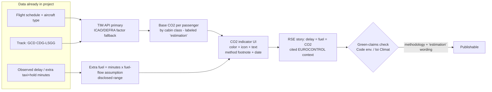

# Research Report — Compliance, Ethics & RSE
**Project: "Plateforme d'intelligence aéronautique" CDG (LFPG) → LSGG · RGPD ADS-B · Disclaimer · Green IT/RGESN · Carbon transparency · WCAG 2.2 · SWOT-RSE**
*Scope note: ML/metrics, architecture and flight-data endpoints are covered by other agents; only referenced here where compliance touches them.*

---

## 1. RGPD / GDPR for ADS-B tracking

### 1.1 Is aircraft tracking personal data?

- Flightradar24's own flight-tracking privacy policy (Dec 2025) states it processes **ICAO 24-bit hex code, position, lat/long, altitude, speed, direction, squawk, country of registration, registration number**, and that "data may relate to aircraft owned or used by private individuals… **personal data is only processed when such indirect identification is feasible**" — i.e., when the registration number is linked to national aircraft registers or other sources ([FR24 Privacy Policy – Flight Tracking](https://www.flightradar24.com/privacy-policy-flight-tracking)).
- **Key precedent**: on 30 June 2025, Sweden's IMY issued the final Art. 60 GDPR decision (case **DI-2021-3397**) establishing that **aircraft registration numbers can constitute personal data** under GDPR, relying on CJEU *Breyer* (C-582/14, dynamic IP) and *Gesamtverband Autoteile-Handel* (C-319/20, VIN) — even **company-owned aircraft count** (a Danish CEO, sole pilot of his firm's helicopter, was deemed identifiable). IMY nevertheless **upheld legitimate interest under Art. 6(1)(f)** ([EDPB public decision PDF](https://www.edpb.europa.eu/system/files/2025-08/se-2025-06-decision-public_0.pdf); analysis: [Blockint, Apr 2026](https://www.blockint.nl/background-research/privacy-as-a-shield-how-gdpr-is-becoming-a-tool-for-the-powerful)).
- **"Indirectly personal" trigger (for the cahier des charges)**: a trajectory becomes personal data when icao24/registration ↔ a natural person link exists (private individuals, sole-shareholder/sole-pilot operators, public figure aircraft). Commercial airliners owned by airlines → not personal data in practice; private jets → yes. This is exactly why erasure/blocking is only promised to *private* owners.

### 1.2 Legal basis: legitimate interest, not consent

- **Legitimate interest (Art. 6(1)(f))** is the established choice for flight-tracking transparency: FR24 documents a full **balancing test** ("our legitimate interest, together with the legitimate interests of third parties, outweighs the limited risk to data subjects… safeguards: right to block aircraft from public display") — and IMY validated it ([FR24 policy, "Legal basis"](https://www.flightradar24.com/privacy-policy-flight-tracking)).
- CNIL conditions for IL (3 conditions): (1) interest **legitimate** (lawful, clearly defined, real & present), (2) **necessary** (no less intrusive means), (3) **balancing** vs. data subjects' rights *and their reasonable expectations*; IL "is not a default basis", must be **documented**, and triggers **reinforced transparency** (the nature of the interest must be stated to individuals; no portability right) ([CNIL – L'intérêt légitime](https://cnil.fr/fr/les-bases-legales/interet-legitime)).
- **Consent (Art. 6(1)(a)) is a poor fit**: tracking happens before/without any user interaction, the data largely comes from public radio frequencies, and asking a platform to obtain consent from aircraft owners is unworkable; IL is reserved to private-sector controllers with no significant imbalance (CNIL, same page). CNIL's general legal-basis guidance: [Licéité – les bases légales](https://www.cnil.fr/fr/les-bases-legales/liceite-essentiel-sur-les-bases-legales).
- Master texts: [RGPD / Reg. (EU) 2016/679](https://eur-lex.europa.eu/eli/reg/2016/679/oj) (Art. 5(1)(e) storage limitation, 6(1)(f), 12–22 rights, 35 DPIA, Chapter V transfers).

### 1.3 Cahier-des-charges commitments — verification status & implementation

| Commitment | External anchor (verified) | Status | Student-scale implementation |
|---|---|---|---|
| **30-day decorrelation of historical trajectories from icao24** | GDPR Art. 5(1)(e) storage limitation ([RGPD](https://eur-lex.europa.eu/eli/reg/2016/679/oj)); FR24 retains "only as long as necessary" ([FR24 policy](https://www.flightradar24.com/privacy-policy-flight-tracking)) — **no public "30-day" standard exists** `[INFERENCE: commitment is program-specific, verify exact wording in your cahier des charges]` | To verify in cahier des charges | Store `icao24↔registration` mapping in a **separate table/store** from history; nightly job: for rows >30 days, **drop icao24 or replace with salted rotating hash**, keep only route/flight-level aggregates; document the job (date, row counts) as proof |
| **Right-to-erasure for private jet owners** | FR24 precedent: "right to request that their aircraft is **blocked from public display**" via `support@fr24.com` with name + icao24 hex + proof of ownership ([FR24 policy, "Your rights"](https://www.flightradar24.com/privacy-policy-flight-tracking)); GDPR Art. 17 (+ Art. 17(3) exceptions, Art. 85 press-freedom tension — [Blockint](https://www.blockint.nl/background-research/privacy-as-a-shield-how-gdpr-is-becoming-a-tool-for-the-powerful)) | Legally grounded | Publish a contact address + 48h SLA; script that deletes/purges all rows for a given icao24 (live + history + backups rotation); keep a **request log** as accountability evidence |
| **EU-only hosting for logs** | GDPR Chapter V for third-country transfers; FR24 shares outside EU/EEA only via **SCCs** ([FR24 policy, "Disclosure"](https://www.flightradar24.com/privacy-policy-flight-tracking)) | Recommended & easy at student scale | Pin Docker volumes/Kafka topics/Postgres & log files to **EU-region infra** (any FR/DE provider); avoid US SaaS that ingests identifiers (error trackers, hosted analytics) or document SCCs; state "données hébergées dans l'UE" in the privacy notice only if actually true |

### 1.4 DPIA / *analyse d'impact* (AIPD) — when required

- Mandatory when processing is **likely to result in a high risk** (Art. 35 RGPD). CNIL: the **9 WP29 criteria**; "**if your processing meets at least 2 criteria, an AIPD is strongly advised**"; it must be done **before** deployment, is iterative, and contains (i) description & purposes, (ii) necessity/proportionality assessment, (iii) risks + measures ([CNIL – Gérer les risques](https://cnil-d10.cnil.fr/fr/gerer-les-risques), canonical [cnil.fr/fr/gerer-les-risques](https://www.cnil.fr/fr/gerer-les-risques)).
- French **mandatory list** (Délibération CNIL n° 2018-327): includes "**Traitements de données de localisation à large échelle**" ([Légifrance](https://www.legifrance.gouv.fr/cnil/id/CNILTEXT000037560659)).
- **Assessment for this project** `[INFERENCE]`: full-route historical trajectories keyed (even indirectly) by icao24 = large-scale location data for the private-jet subset → you plausibly hit (a) large-scale location data, (b) systematic surveillance, (c) data crossing/enrichment (ADS-B × registers) = **≥2–3 criteria → write a lightweight AIPD**.
- **Minimal student AIPD (½ day)**: 1–2 pages using CNIL's free **PIA software** templates ([CNIL – Outil PIA](https://www.cnil.fr/fr/outil-pia-telechargez-et-installez-le-logiciel-de-la-cnil)): description of the ADS-B pipeline; IL balancing-test summary (mirror FR24's reasoning); risks (re-identification of private owners, function creep, data breach) × measures (30-day decorrelation, erasure route, EU hosting, no user accounts needed); review date.

### 1.5 CNIL guidance — the 5 points to quote in the cahier des charges

1. Legal basis = **Art. 6(1)(f) legitimate interest**, documented balancing test (CNIL 3-condition method, link above).
2. **Reinforced transparency**: privacy notice must state the legitimate interest pursued (CNIL page, "Conséquences du choix").
3. **Rights**: access/erasure/restriction applicable to indirectly-identifiable owners → blocking mechanism (FR24 model).
4. **Storage limitation** → 30-day decorrelation job + retention table.
5. **Accountability**: register of processing (even a 10-line spreadsheet), AIPD if ≥2 criteria, security measures (Art. 32: TLS, secrets in env vars, minimal logs).

### 1.6 Minimal compliance checklist (student scale, ~2–3 days total)

- [ ] **Privacy notice** (1 page, French): data categories (icao24, positions, no names), purpose (delay research/education), **legal basis Art. 6(1)(f) + explicit statement of the interest**, retention (30-day decorrelation; aggregates longer), rights + contact email, EU hosting statement.
- [ ] **Legitimate-interest record** (1 page): interest / necessity / balancing / safeguards — CNIL-recommended documentation.
- [ ] **AIPD-lite** with CNIL PIA template; date it before Sprint deployment.
- [ ] **Erasure workflow**: contact → verify claim (name + icao24 + proof) → purge live+history → log the request.
- [ ] **Decorrelation job** with an evidence log (date, rows affected).
- [ ] **No accounts / no cookies needed** for a public map → no consent banner (keep it that way: no third-party trackers) `[INFERENCE]`.
- [ ] **Data-source terms** respected (see §2 for FR24 API caching/usage limits).
- [ ] DPO: not required at this scale `[INFERENCE — Art. 37 exemptions; core activity isn't large-scale systematic monitoring of individuals]`; designate a "point de contact données personnelles" anyway.

```mermaid
flowchart TD
    A[ADS-B trajectory: icao24 + position] --> B{Linkable to a natural person?<br/>private jet / register join]
    B -- No - commercial airliner --> C[Not personal data in practice<br/>still handle responsibly]
    B -- Yes - indirect identification --> D[Personal data per IMY DI-2021-3397]
    D --> E{Legal basis?}
    E --> F[Art 6(1)(f) legitimate interest<br/>documented balancing test<br/>NOT consent]
    F --> G[Safeguards required:<br/>1 privacy notice stating the interest<br/>2 erasure/block route for owners<br/>3 30-day icao24 decorrelation on history<br/>4 EU-only logs]
    G --> H{DPIA?<br/>CNIL: >=2 of 9 criteria<br/>FR list: large-scale location data}
    H -- Yes, borderline --> I[AIPD-lite with CNIL PIA tool<br/>before go-live]
    H -- No --> J[Register + review on change]
    I --> J
```

---

## 2. Data-security / coverage disclaimer (military, state & filtered flights)

**Pattern used by Flightradar24 (Terms of Service, 23 June 2026 version), clause 14.6** — verbatim structure to adapt ([FR24 Terms](https://www.flightradar24.com/terms-of-service)):

> "…the provided information on aircraft position and identity… originate directly from the aircraft, which transmit this information through public radio frequencies (ADS‑B). **The information collected and published may contain errors, due to the intrinsic limitations of radio communications (e.g. limited coverage, interference, attenuation, special weather conditions etc.), due to erroneous configuration of the ADS‑B devices on board, due to negligent data entry by aircraft crew, due to erroneous position received by the aircraft GPS and due to other factors beyond the control of Flightradar24. Data is provided for informational purposes only and is not related by any means to the safety of navigation.** Consequently, we cannot provide any type of guarantee and are neither responsible for the correctness, validity, thoroughness and accuracy of that information…"

Plus two complementary clauses: **6.3.1(4)** — FR24 *explicitly prohibits* using its data "for any flight-critical or safety-critical decisions"; **§14.1** "as is / as available" warranty disclaimer; **§2.3/2.4** — no scraping outside the API, and API cache only "for a limited time as documented per endpoint" (relevant to your caching lever, §3).

**Suggested disclaimer block for our app (adapt, don't pretend it's legally approved):**

```text
Couverture non exhaustive : les données affichées proviennent de récepteurs ADS-B
et de sources publiques. Certaines opérations n'apparaissent pas ou sont masquées
(avions d'État, militaires, missions sensibles, transpondeurs désactivés ou hors
portée des récepteurs) : la couverture n'est pas garantie à 100 % et des écarts
peuvent exister avec la situation réelle.
Données fournies à titre informatif uniquement, sans garantie d'exactitude,
de complétude ni de fraîcheur. Ne pas utiliser pour toute décision opérationnelle
ou liée à la sécurité du vol.
Les retards et prédictions affichés sont des estimations pédagogiques [Modèle ML -
méthode et limites : lien], ne constituent pas une information officielle (référencez
vos sources type EUROCONTROL/aéroports) et ne doivent pas fonder une décision.
```

- Grounding for "military/state/filtered": FR24 itself states coverage has "limited coverage" limitations (14.6) and the community note that major platforms may lack records for certain state aircraft ([Blockint](https://www.blockint.nl/background-research/privacy-as-a-shield-how-gdpr-is-becoming-a-tool-for-the-powerful), Khashoggi/Sky Prime example) → the honest wording is "coverage is not 100%; some flights are absent or filtered", **not** "all traffic shown".

---

## 3. Green IT / eco-design (RGESN & concrete levers)

### 3.1 The reference: RGESN

- **Référentiel général d'écoconception de services numériques (RGESN)**: launched by DINUM/MiNumÉco (with ADEME, INR) in Dec 2022 with **79 criteria in 8 themes** — stratégie, spécifications, architecture, UX/UI, contenus, frontend, backend, hébergement ([DINUM announcement](https://www.numerique.gouv.fr/actualites/numerique-ecoresponsable-les-administrations-peuvent-desormais-sappuyer-sur-un-referentiel-general-decoconception)); **version 2024 (v2, 28 May 2024)** online + PDF, with an added **"Algorithmie"** theme in the online TOC ([RGESN v2](https://ecoresponsable.numerique.gouv.fr/publications/referentiel-general-ecoconception), [PDF](https://ecoresponsable.numerique.gouv.fr/docs/2024/rgesn-mai2024/referentiel_general_ecoconception_des_services_numeriques_version_2024.pdf)); third-party sources say **78 criteria in v2** `[INFERENCE: exact v2 count 78 vs 79 to confirm]`.
- Legal context: **Loi REEN n° 2021-1485** ([Légifrance](https://www.legifrance.gouv.fr/jorf/id/JORFTEXT000044327272)) tasked **Arcep/Arcom** with this référentiel ([Wikipedia FR](https://fr.wikipedia.org/wiki/R%C3%A9f%C3%A9rentiel_g%C3%A9n%C3%A9ral_de_l'%C3%A9coconception_des_services_num%C3%A9riques)); RGESN is **binding for the State/administrations but explicitly "usable by any organisation"** (DINUM announcement) → **voluntary but excellent RSE evidence** for students.
- Self-assessment tool: **NumÉcoDiag** browser add-on (Firefox/Chrome/Edge) → score + downloadable **badge** + CSV export (DINUM announcement) — a ready-made "déclaration d'écoconception" artifact for the jury.

### 3.2 Applicable RGESN criteria for this project (table)

| Criterion | Question (title) | Our application |
|---|---|---|
| [1.5](https://ecoresponsable.numerique.gouv.fr/publications/referentiel-general-ecoconception/#strategie) | Usable on terminals >5 years old | Keep React/Streamlit bundles light; no heavy 3D globe |
| [2.8](https://ecoresponsable.numerique.gouv.fr/publications/referentiel-general-ecoconception/critere/2.8) | Suppliers must commit to reducing impacts | Note in data/API provider choice (OSS, EU hosts) |
| [3.2](https://ecoresponsable.numerique.gouv.fr/publications/referentiel-general-ecoconception/critere/3.2) | Architecture adapts resources to consumption | Right-size Docker containers; idle-scale down Kafka/Postgres; measure allocated-vs-consumed ratio (control method given in the criterion) |
| [3.7](https://ecoresponsable.numerique.gouv.fr/publications/referentiel-general-ecoconception/critere/3.7) | Optimize dev/test environment solicitation | Spin CI/kafka-connect stacks only when needed; scheduled teardown |
| [4.1](https://ecoresponsable.numerique.gouv.fr/publications/referentiel-general-ecoconception/critere/4.1) | Only animations/videos/sounds with autoplay **disabled** | Map marker animations paused by default (also pairs with WCAG 2.2 §5) |
| [4.9](https://ecoresponsable.numerique.gouv.fr/publications/referentiel-general-ecoconception/critere/4.9) | Limit server requests during user input | Debounce map search/autocomplete; no per-keystroke API calls |
| [4.12](https://ecoresponsable.numerique.gouv.fr/publications/referentiel-general-ecoconception/critere/4.12) | Warn user when a feature has high environmental impact | e.g. "actualisation continue activée" indicator |
| [4.13](https://ecoresponsable.numerique.gouv.fr/publications/referentiel-general-ecoconception/critere/4.13) | Limit notifications + let user disable them | If alert features exist |
| [4.15](https://ecoresponsable.numerique.gouv.fr/publications/referentiel-general-ecoconception/critere/4.15) | Give users control to track/reduce their usage | **User-selectable refresh rate (live vs 5 min) & reduced-motion toggle** |
| [8.1](https://ecoresponsable.numerique.gouv.fr/publications/referentiel-general-ecoconception/critere/8.1) / [8.5](https://ecoresponsable.numerique.gouv.fr/publications/referentiel-general-ecoconception/critere/8.5) | Hosting with footprint-reduction approach / documented, majority-renewable electricity | Choose EU host publishing energy mix (also serves §1 EU-hosting commitment) |

### 3.3 Concrete levers

- **Caching to cut API calls**: Redis cache for flight statuses/airport lookups; respect upstream cache TTLs (FR24 API: cache "for a limited time as documented per endpoint", no persistent local copies — [ToS §2.4/6.3.1](https://www.flightradar24.com/terms-of-service)); serve map snapshots/JSON with HTTP caching. Eco (RGESN 3.2/4.9) and legal goals align.
- **Dark mode default**: OLED savings are real for dark pixels — Purdue MobiSys'21 OLED power profiler ([ACM DL](https://dl.acm.org/doi/10.1145/3458864.3467682)) — but overall savings are device/usage-dependent, smaller on LCD ([Ars Technica summary](https://arstechnica.com/gadgets/2025/02/small-study-suggests-dark-mode-doesnt-save-much-power-for-very-human-reasons)) → default `prefers-color-scheme`-driven theme + dark default for the map (also helps contrast control §5). Do **not** advertise "dark mode = green" as a hard claim (§4 green-claims note).
- **Efficient stack**: Polars (lazy, zero-copy) over pandas for the 18-sprint data volumes, FastAPI + async for the API, vector tiles/simplified GeoJSON instead of raw point streams — rational choices `[INFERENCE on magnitude of savings; no benchmark cited]`.
- **ML training compute budget**: cap experiments (e.g., "≤ X GPU-hours / CPU-hours per sprint", log runtimes), tune with early stopping, prefer small tabular models (gradient boosting) over deep nets for tabular delay prediction — governed by RGESN 3.2/3.7; report the budget in the RSE section as a *measured* number.
- **Measure the service's footprint simply** (pick 1 primary + 1 cross-check):

| Tool | What it does | Cost | Source |
|---|---|---|---|
| **BoaviztAPI** (`pip install boaviztapi`) | Bottom-up environmental impact of IT components/workloads (CPU/RAM/storage/cloud), open methodology | Free, OSS | [PyPI](https://pypi.org/project/boaviztapi/), [docs](https://doc.api.boavizta.org/), [Boavizta tools](https://boavizta.org/en/tools) |
| **GreenFrame** (`greenframe-cli`, Marmelab) | Estimates carbon of a *user scenario* on a web app (drives a browser, measures energy) | OSS CLI; hosted service exists | [greenframe.io](https://greenframe.io/), [docs](https://docs.greenframe.io/), [GitHub](https://github.com/marmelab/greenframe-cli) |
| **Electricity Maps / CO₂ Signal** | Live grid carbon intensity (gCO₂/kWh) — e.g., to time batch jobs or state "hébergé en France, mix FR" | API mostly paid tiers `[INFERENCE: free-tier terms not verified]` | [API docs](https://app.electricitymaps.com/api/docs/reference), [CO2 Signal rename evidence](https://www.home-assistant.io/integrations/co2signal) |
| **ADEME** (Base Carbone & usage calculators) | Official emission factors ( kWh electricity FR, devices, data practices) | Free | [ADEME usages numériques calculator](https://agirpourlatransition.ademe.fr/particuliers/evaluer-son-impact/calculer-empreinte-carbone/calculez-empreinte-carbone-usages-numériques), [data.ademe.fr](https://data.ademe.fr/datasets) |
| "HubInOut" emission factors | Named in the assignment | **No primary source found in this research — do not cite; treat as `[INFERENCE]`/drop** | — |

**Simple estimation recipe**: (1) inventory services (`docker stats`, kWh ≈ CPU-hours × measured TDP `[INFERENCE]`); (2) convert with BoaviztAPI + ADEME electricity factor; (3) add usage phase via GreenFrame scenario run; (4) publish a ½-page "bilan simplifié" with assumptions. Order of magnitude honesty: for a small self-hosted student stack, **usage-phase energy of user devices usually dominates** — say so (ADEME calculator makes this visible).

---

## 4. Carbon transparency feature (per-flight CO₂)

### 4.1 Standard methodologies

| Method | Key mechanics (verified) | Source |
|---|---|---|
| **ICAO ICEC, Methodology v13.1 (Aug 2024)** | Inputs: origin/destination → **Great Circle Distance**, corrected **+50 km (<550 km) / +100 km (550–5,500) / +125 km (>5,500)**; scheduled aircraft mapped to **336 equivalent types** with ICAO fuel formulas; **passenger load factor & pax-to-cargo factor per route group** (53 intl + 11 domestic + 11 intra; e.g. **Intra-Europe pax LF 82.3 %**, data yr 2016); **cabin class via "Yseat" seat-surface multiplier**; fuel → CO₂ with constant **3.16 kg CO₂/kg fuel**; openly documented sensitivities (GCD vs actual up to **+11 % in Europe**, fleet/config variance) | [ICAO methodology PDF](https://icec.icao.int/Documents/Methodology%20ICAO%20Carbon%20Emissions%20Calculator_v13_Final.pdf), [ICEC page](https://www.icao.int/environmental-protection/environmental-tools/icec) |
| **DEFRA/DESNZ GHG Conversion Factors 2025** | Published **10 June 2025**; kg CO₂e **per passenger-km** by haul length (domestic/short/long), plus per pax journey; accompanied by methodology paper | [GOV.UK publication](https://www.gov.uk/government/publications/greenhouse-gas-reporting-conversion-factors-2025), [methodology paper](https://assets.publishing.service.gov.uk/media/6846b0870392ed9b784c0187/2025-GHG-CF-methodology-paper.pdf), [condensed factors XLSX](https://assets.publishing.service.gov.uk/media/6846a4e6d25e6f6afd4c0180/ghg-conversion-factors-2025-condensed-set.xlsx) |
| **EEA / EASA-EUROCONTROL** | Benchmark per passenger-km comparisons (TERM27); European Aviation Environmental Report 2025 for policy context | [EEA TERM27](https://www.eea.europa.eu/en/analysis/maps-and-charts/term27-specific-co2-emissions-per-passenger-km-and-per-mode-of-transport-in-europe), [EAER 2025 PDF](https://www.eurocontrol.int/sites/default/files/2025-01/eurocontrol-easa-eaer-2025.pdf) |
| **Google Travel Impact Model (TIM) API** | **Public and free of charge** (API key), data **CC BY-SA 4.0**, methodology on GitHub; per-passenger grams **by cabin class**; up to **1,000 legs/request**; covers **commercial flights departing in the next 11 months — no private/charter/cargo, no past flights**; returns contrails-impact bucket; MCP supported | [TIM API overview](https://developers.google.com/travel/impact-model), [computeFlightEmissions reference](https://developers.google.com/travel/impact-model/docs/reference/rest/v1/flights/computeFlightEmissions), [methodology GitHub](https://github.com/google/travel-impact-model) |
| **myclimate** | Public flight calculator (GCD-based, offset-oriented); **no documented free public API found** `[INFERENCE]` | [myclimate flight calculator](https://co2.myclimate.org/en/flight_calculators/new) |

### 4.2 Key inputs & accuracy caveats (must appear in the UI footnote)

- **Inputs**: great-circle distance (+ICAO correction), aircraft type (schedule or fleet average), **load factor** (route-group average), **cabin class** (multiplier), pax-vs-cargo split, fuel→CO₂ constant 3.16 (ICAO) — ICAO PDF as above.
- **Caveats**: GCD ≠ flown path (routing/weather/stacking, up to +11 % in Europe); representative-aircraft fuel curves vary by age/engines; load factors are annual route-group averages; cabin configurations vary; **ICAO/DEFRA are CO₂-only unless you explicitly add radiative forcing** (TIM includes non-CO₂/contrail signal as a separate bucket) — state which convention you use; ±10–20 % error band for a generic estimate `[INFERENCE, consistent with ICAO §5 sensitivity discussion]`.
- **Recommended design for CDG→LSGG**: **primary = TIM API** (exact flight, free, per-cabin) → **fallback = ICAO-style offline factor table** (route distance ~400–450 km `[INFERENCE: compute exact GCD from airport coordinates yourself]`, intra-Europe load factor 82.3 %); display "**estimation**" + methodology link + caveats.
- **Green-claims risk** (French law): environmental claims to consumers must not be vague/unjustified — Code de la consommation practices rules ([ecologie.gouv.fr – Allégations environnementales](https://www.ecologie.gouv.fr/politiques-publiques/allegations-environnementales)); loi Climat & Résilience art. 12 bans certain allegations ([notre-environnement.gouv.fr](https://www.notre-environnement.gouv.fr/donnees-et-ressources/ressources/liens-utiles/article/article-12-de-la-loi-climat-et-resilience-du-22-aout-2021-concernant-l)); environmental-claim rules at Code environnement art. D229-106–R229-110 ([Légifrance](https://www.legifrance.gouv.fr/codes/id/LEGIARTI000045576384/2023-01-01)). → Always label as *estimate*, name the method (ICAO/DEFRA/TIM), date the factor version.

---

## 5. Accessibility — WCAG 2.2 conformance for a live map + delay colors

**Legal frame**: European Accessibility Act (Directive (EU) 2019/882) **applies from 28 June 2025** ([Art. 31](https://www.legislation.gov.uk/eudr/2019/882/article/31)); covers listed services incl. **air passenger transport** among transport services ([EUR-Lex summary](https://eur-lex.europa.eu/legal-content/EN/LSU?uri=CELEX%3A32019L0882)) — but **microenterprises providing services are exempt** ([Art. 4(5)](https://www.legislation.gov.uk/eudr/2019/882/article/4)), and a delay-prediction site is not itself a transport service → **not legally binding here** `[INFERENCE on scope conclusion]`. Adopt **WCAG 2.2 level AA** as the voluntary target ([W3C REC](https://www.w3.org/TR/WCAG22); what's new in 2.2: [WAI](https://www.w3.org/WAI/standards-guidelines/wcag/new-in-22/)).

### 5.1 Criteria that matter for this UI

| Criterion (WCAG 2.2) | Level | Application to our map/delays |
|---|---|---|
| 1.4.3 Contrast (Minimum) **4.5:1** (3:1 large text) | AA | Delay labels/legends on map backgrounds — pin badges/popups included |
| 1.4.11 Non-text contrast **3:1** | AA | Map control borders, marker outlines, focus rings vs. tile colors |
| 1.4.1 Use of Color | A | **Never encode green/orange/red delay status by hue alone** |
| 2.1.1 / 2.1.2 Keyboard (no trap) | A | Leaflet/Maplibre containers must be operable & escapable by keyboard (document Tab-in/Tab-out or Esc) |
| 2.2.2 Pause, Stop, Hide | A | Live auto-updating positions/moving markers need a pause control (>5 s auto-updates) |
| 2.3.3 Animation from Interactions (new in 2.2) | AA | Honor `prefers-reduced-motion`; make camera fly-to/animations non-essential or disable-able |
| 2.4.11 Focus Not Obscured (Minimum) (new) | AA | HUD/legend overlays mustn't hide the focused element |
| 2.5.8 Target Size (Minimum) **24×24 CSS px** (new) | AA | Map zoom/legend controls |
| 3.2.6 Consistent Help / 3.3.7–3.3.8 (new) | A/AA | If you add search/help or recurring inputs — consistent placement/autocomplete |
| **4.1.3 Status Messages** | AA | **ARIA `role="status"`/`aria-live="polite"`** for delay-status changes & position refreshes — announced without stealing focus ([Understanding SC 4.1.3](https://www.w3.org/WAI/WCAG22/Understanding/status-messages.html)) |

All numeric values above: [WCAG 2.2 REC](https://www.w3.org/TR/WCAG22).

### 5.2 Quick conformance checklist (1–2 sprints)

- [ ] Delay status = **color + icon + text label** (e.g., 🟢 "À l'heure" / 🟠 "Retard > 30 min" / 🔴 "Annulé") + 4.5:1 text contrast checked with a contrast analyzer in both light & dark themes.
- [ ] Marker/legend colors checked ≥3:1 against the actual basemap tiles.
- [ ] `aria-live="polite"` status region for "vol AFxxxx : retard 45 min" updates — **throttled** (batch per refresh cycle, not per packet).
- [ ] Full **keyboard path**: Tab to map → arrows pan → +/- zoom → Enter select → **documented exit**; visible focus ring ≥3:1, never hidden under the legend.
- [ ] Pause button for live refresh (doubles as RGESN 4.15 user control); default interval moderate (e.g., 30–60 s).
- [ ] `prefers-reduced-motion: reduce` honored (no fly-to/pan animation, instant marker moves).
- [ ] Targets ≥24×24 px; reflow usable at 320 px width (1.4.10) — mobile map controls stack.
- [ ] Text alternative for the map: a sortable **table of flights/delays** (also benefits SEO/privacy transparency) (1.1.1).
- [ ] Page language, headings, and legend semantics (`<ul>`, `aria-label` on layer toggles).
- [ ] Run one automated pass (axe) + one manual keyboard-only walkthrough before the demo.

---

## 6. SWOT crossover RSE idea — CO₂ indicator correlated to delay/fuel burn

**Feasibility: HIGH for display, MEDIUM for the "delay penalty" delta, with honest framing.**

- **Solid part**: base per-flight CO₂ for CDG→LSGG via TIM API or ICAO/DEFRA factors (§4) — deterministic, citable, no new data needed.
- **Novel part**: *marginal* CO₂ of delay = extra taxi/holding time × aircraft fuel flow. Inputs available in your own pipeline (delay minutes, taxi-in/out from ADS-B tracks). **Fuel-flow-per-minute assumptions (e.g., A320 taxi/hold ~2–3 kg/min `[INFERENCE — needs a citable source such as airline FCOM/EEC figures before publishing numbers]`)** must be disclosed; present results as a **range**, not a point value.
- **Grounding for the narrative**: EUROCONTROL publishes all-causes delay analytics you can cite for context ([Annual 2024 digest](https://www.eurocontrol.int/publication/all-causes-delays-air-transport-europe-annual-2024)); EAER 2025 for environmental context ([PDF](https://www.eurocontrol.int/sites/default/files/2025-01/eurocontrol-easa-eaer-2025.pdf)).
- **Why it's a good SWOT "opportunity/strength"**: it fuses the two project pillars (delay ML + carbon transparency), is *differentiating* vs. pure delay apps, and is cheap to build (one table: flight → base CO₂, delay min, extra-CO₂ estimate, cumulative daily total shown as "CO₂ supplémentaire dû aux retards aujourd'hui sur CDG–LSGG").
- **Risks (SWOT threats/weaknesses)**: single short-haul route limits statistical story `[INFERENCE]`; claim-substantiation law (§4) means "extra CO₂" must show formula + assumptions; correlation ≠ causation in any delay↔CO₂ chart; non-CO₂ effects choice (RF) must be stated; don't imply operational recommendations (disclaimer §2).
- **Verdict**: ship it as a clearly-labelled **pedagogical indicator with visible methodology**, not as a measured value.



---

## 7. Consolidated obligations table

| Obligation | Source / law | Applies to student project? | Student-scale action |
|---|---|---|---|
| Identify & document lawful basis | RGPD Art. 6(1)(f); [CNIL intérêt légitime](https://cnil.fr/fr/les-bases-legales/interet-legitime) | **Yes** if trajectories can be indirectly linked to individuals | 1-page legitimate-interest record + privacy notice stating the interest |
| Transparency to individuals (nature of IL stated) | CNIL IL page (reinforced transparency) | Yes (same condition) | "Mentions RGPD" page in the app footer |
| Right to erasure / blocking for private-jet owners | RGPD Art. 17; [FR24 precedent](https://www.flightradar24.com/privacy-policy-flight-tracking); IMY DI-2021-3397 ([EDPB PDF](https://www.edpb.europa.eu/system/files/2025-08/se-2025-06-decision-public_0.pdf)) | Yes | Contact email + purge script + request log |
| Storage limitation → **30-day decorrelation** of history from icao24 | RGPD Art. 5(1)(e); cahier des charges `[INFERENCE: exact wording to verify]` | Yes | Separate key store; nightly job decorrelates >30 d rows; evidence log |
| EU-only hosting of logs/DB | RGPD Chapter V; FR24 SCC contrast (same policy) | Recommended (also an RSE selling point) | EU-region infra only; list of hosts in documentation |
| DPIA / AIPD when high risk (≥2 CNIL criteria; FR list includes **large-scale location data**) | RGPD Art. 35; [CNIL criteria](https://cnil-d10.cnil.fr/fr/gerer-les-risques); [Délib. 2018-327](https://www.legifrance.gouv.fr/cnil/id/CNILTEXT000037560659) | **Likely yes** `[INFERENCE]` | AIPD-lite with [CNIL PIA tool](https://www.cnil.fr/fr/outil-pia-telechargez-et-installez-le-logiciel-de-la-cnil), dated pre-deployment |
| Security of processing (Art. 32) | RGPD Art. 32 | Yes | TLS, env-var secrets, minimal logs, no accounts → no password risk |
| DPO designation | RGPD Art. 37 | Probably not (small scale, no special-category data) `[INFERENCE]` | Name a contact point anyway |
| Upstream data terms (no scraping, time-limited caching, no flight-critical use, attribution) | [FR24 ToS §2.3/2.4/6.3/8.2](https://www.flightradar24.com/terms-of-service) | Yes if FR24 API used (check your provider's ToS — other agent) | Cache TTL table per endpoint; attribution line in footer; disclaimer §2 |
| Coverage/data-accuracy disclaimer | FR24 ToS 14.6 pattern (verified above) | Yes | Suggested wording block in §2 |
| Eco-design (RGESN) | [RGESN v2024](https://ecoresponsable.numerique.gouv.fr/publications/referentiel-general-ecoconception); loi REEN ([Légifrance](https://www.legifrance.gouv.fr/jorf/id/JORFTEXT000044327272)) | Voluntary (not an administration) → **strong RSE evidence** | NumÉcoDiag self-assessment + ½-page déclaration d'écoconception; levers §3 |
| Accessibility | EAA 2019/882 from 28/06/2025, **microenterprise service exemption** ([Art. 4(5)](https://www.legislation.gov.uk/eudr/2019/882/article/4)); not a transport service `[INFERENCE]` | **Not legally binding** → adopt [WCAG 2.2 AA](https://www.w3.org/TR/WCAG22) voluntarily | Checklist §5.2 |
| Substantiated environmental claims (CO₂ figures) | [ecologie.gouv.fr allégations](https://www.ecologie.gouv.fr/politiques-publiques/allegations-environnementales); loi Climat art. 12 ([source](https://www.notre-environnement.gouv.fr/donnees-et-ressources/ressources/liens-utiles/article/article-12-de-la-loi-climat-et-resilience-du-22-aout-2021-concernant-l)); Code env. D229-106–R229-110 | Only if you make public green claims → yes, you will | Label "estimation", cite method (ICAO/DEFRA/TIM) + factor version + date |
| Consumer/operational misuse guard | FR24 ToS 6.3.1(4) precedent | Yes | "Not for operational use" in ToS/disclaimer |

---

## Recommended source stack (this report's categories)

| Category | Primary | Backup | Rationale | Risk |
|---|---|---|---|---|
| Legal basis & GDPR guidance | [CNIL – intérêt légitime](https://cnil.fr/fr/les-bases-legales/interet-legitime) + [bases légales](https://www.cnil.fr/fr/les-bases-legales/liceite-essentiel-sur-les-bases-legales) | [RGPD text EUR-Lex](https://eur-lex.europa.eu/eli/reg/2016/679/oj) | CNIL = French regulator, actionable; regulation = authoritative | CNIL site occasionally 503 → mirror `cnil-d10.cnil.fr` worked |
| Flight-tracking personal-data precedent | [FR24 flight-tracking privacy policy](https://www.flightradar24.com/privacy-policy-flight-tracking) | [IMY decision PDF](https://www.edpb.europa.eu/system/files/2025-08/se-2025-06-decision-public_0.pdf) | Policy = operational template; decision = binding Art. 60 outcome | Decision is Swedish-language-heavy; use [Blockint analysis](https://www.blockint.nl/background-research/privacy-as-a-shield-how-gdpr-is-becoming-a-tool-for-the-powerful) for readable summary (secondary) |
| DPIA trigger & templates | [CNIL – Gérer les risques](https://cnil-d10.cnil.fr/fr/gerer-les-risques) | [Délib. 2018-327](https://www.legifrance.gouv.fr/cnil/id/CNILTEXT000037560659) + PIA tool | 9-criterion test + mandatory FR list + free tool | List is non-exhaustive → Art. 35(1) catch-all still applies |
| Disclaimer wording | [FR24 ToS §14.6/§6.3](https://www.flightradar24.com/terms-of-service) | Your provider's own ToS (see data-endpoint agent) | Industry-standard pattern, legally vetted text | Don't copy verbatim; adapt + translate |
| Eco-design référentiel | [RGESN v2 web](https://ecoresponsable.numerique.gouv.fr/publications/referentiel-general-ecoconception) + [PDF](https://ecoresponsable.numerique.gouv.fr/docs/2024/rgesn-mai2024/referentiel_general_ecoconception_des_services_numeriques_version_2024.pdf) | [NumÉcoDiag](https://ecoresponsable.numerique.gouv.fr/publications/referentiel-general-ecoconception/numecodiag/) via [DINUM announcement](https://www.numerique.gouv.fr/actualites/numerique-ecoresponsable-les-administrations-peuvent-desormais-sappuyer-sur-un-referentiel-general-decoconception) | Criterion-level objective/verification text; badge output for jury | Host DNS sometimes unreachable from abroad → PDF mirror; count 78/79 `[INFERENCE]` |
| Service footprint measurement | [BoaviztAPI](https://doc.api.boavizta.org/) | [greenframe-cli](https://github.com/marmelab/greenframe-cli) + [ADEME calculator](https://agirpourlatransition.ademe.fr/particuliers/evaluer-son-impact/calculer-empreinte-carbone/calculez-empreinte-carbone-usages-numériques) | Boavizta = component/workload math; GreenFrame = scenario measurement; ADEME = official factors | Models ≠ metering — always publish assumptions; "HubInOut" unverified, excluded |
| Grid carbon intensity | [Electricity Maps API](https://app.electricitymaps.com/api/docs/reference) | ADEME French average factor ([data.ademe.fr](https://data.ademe.fr/datasets)) | Live intensity for timing/claims | Paid tiers `[INFERENCE]` → use static ADEME factor if needed |
| Per-flight CO₂ (live flight) | [Google TIM API](https://developers.google.com/travel/impact-model) | [ICAO ICEC methodology](https://icec.icao.int/Documents/Methodology%20ICAO%20Carbon%20Emissions%20Calculator_v13_Final.pdf) offline factors | Free, per-cabin, exact flight; ICAO = offline, transparent fallback | TIM: no past/private flights (irrelevant for scheduled CDG–LSGG); CC BY-SA 4.0 attribution required |
| Per-flight CO₂ (report-grade cross-check) | [DEFRA 2025 factors](https://www.gov.uk/government/publications/greenhouse-gas-reporting-conversion-factors-2025) | [EEA TERM27](https://www.eea.europa.eu/en/analysis/maps-and-charts/term27-specific-co2-emissions-per-passenger-km-and-per-mode-of-transport-in-europe) / [EAER 2025](https://www.eurocontrol.int/sites/default/files/2025-01/eurocontrol-easa-eaer-2025.pdf) | Widely-used, versioned, free; EEA for comparative statements | Per-pax-km averages ignore aircraft type → label as estimate |
| Delay context for RSE narrative | [EUROCONTROL delay digests](https://www.eurocontrol.int/publication/all-causes-delays-air-transport-europe-annual-2024) | EAER 2025 | Official European delay statistics | Monthly/annual granularity, not route-level for CDG–LSGG |
| Accessibility standard | [WCAG 2.2 REC](https://www.w3.org/TR/WCAG22) + [SC 4.1.3 understanding](https://www.w3.org/WAI/WCAG22/Understanding/status-messages.html) | [EAA summary](https://eur-lex.europa.eu/legal-content/EN/LSU?uri=CELEX%3A32019L0882) for legal framing | W3C = the testable standard EAA/EN 301 549 ecosystems point to | Level AA target is voluntary here; document that choice |
| Green claims | [ecologie.gouv.fr](https://www.ecologie.gouv.fr/politiques-publiques/allegations-environnementales) + [Code env. D229-106+](https://www.legifrance.gouv.fr/codes/id/LEGIARTI000045576384/2023-01-01) | [loi Climat art. 12](https://www.notre-environnement.gouv.fr/donnees-et-ressources/ressources/liens-utiles/article/article-12-de-la-loi-climat-et-resilience-du-22-aout-2021-concernant-l) | Official guidance before publishing CO₂ claims | Rules evolving (EmpCo black list 2026 `[INFERENCE — not verified from primary source]`) → re-check before final demo |

**Sprint-ready priorities**: (S1) privacy notice + IL record + disclaimer block; (S2) AIPD-lite + decorrelation job + erasure workflow; (S3) WCAG checklist + NumÉcoDiag assessment; (S4) TIM-based CO₂ indicator with methodology footnote; (S5) footprint measurement (Boavizta/GreenFrame) + compute budget statement → the full RSE chapter for the jury.
